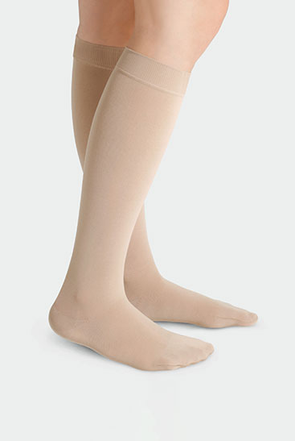
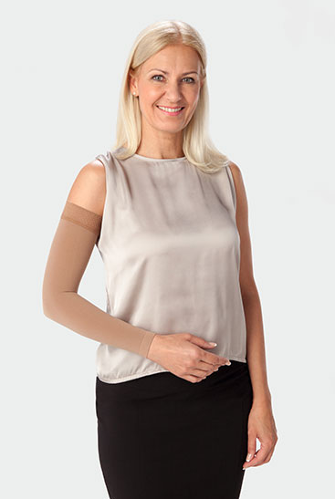
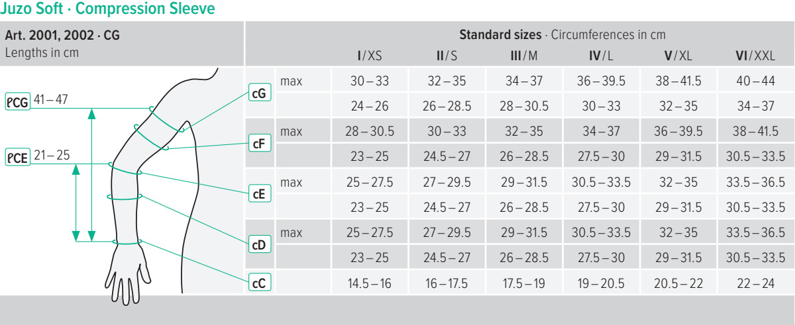
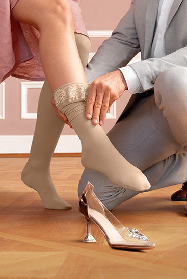
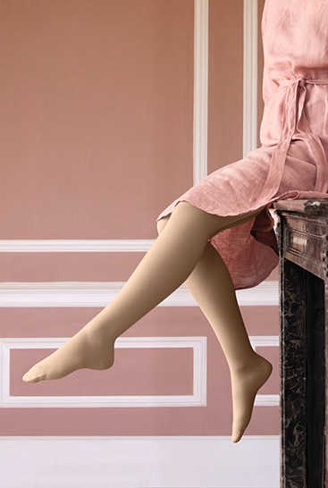
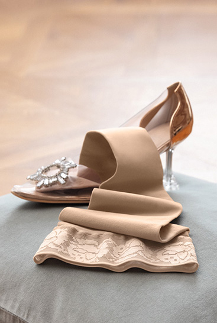

# index.html

```html
<!doctype html><html lang="ar" dir="rtl"><head><meta charset="utf-8"><meta name="viewport" content="width=device-width,initial-scale=1"><title>OrthoServ × Juzo | راحة في كل خطوة</title><link rel="icon" href="assets/orthoserv-logo-symbol.png"><link rel="stylesheet" href="style.css"><link rel="stylesheet" href="shop.css"><script src="motion.js" defer></script><script src="shop.js" defer></script><link rel="stylesheet" href="experience.css"><script src="experience.js" defer></script></head><body>
<header class="shop-header"><div class="brand-pair"><a href="#home" aria-label="OrthoServ"></a><span class="brand-divider" aria-hidden="true"></span><a href="#home" aria-label="Juzo"></a></div><nav aria-label="القائمة الرئيسية"><a href="#catalog">المنتجات</a><a href="#fit-guide">المقاس والعناية</a><a href="#about">عن Juzo</a></nav><div class="head-tools"><button id="play">شغّل المشهد ▷</button><button id="quoteBag" class="bag" aria-label="قائمة الاستفسار">قائمتي <span id="bagCount">0</span></button></div></header>
<main id="home"><section class="story" id="story"><div class="stage" id="stage"><div class="ambient"></div><div class="topline"><span>تفاصيل تتحرّك معك</span><span lang="en">COMPRESSION IN MOTION</span></div>
<div class="intro" id="intro"><p class="eyebrow" lang="en">JUZO COMPRESSION GARMENTS</p><h1>راحة تشعر بها.<br><span>في كل خطوة.</span></h1><p class="body">اكتشف مجموعة Juzo للضغط الطبي،<br>بتفاصيل تناسب حياتك اليومية.</p><div class="rule"></div><p class="sub"><a class="shop-cta" href="#catalog">اكتشف المنتجات <span aria-hidden="true">↗</span></a></p></div>
<div class="leg-scene" id="legScene"><div class="shadow" id="shadow"></div><canvas id="leg" aria-label="تصور ساق ترتدي جورب ضغط رمادي، تنزل في حركة خطوة بطيئة"></canvas></div>
<div class="collection" id="collection"><p class="eyebrow" lang="en">FIND YOUR EVERYDAY FIT</p><h2>خطوتك التالية.<br>اختيار يناسبك.</h2><p>هنا تبدأ رحلة استكشاف منتجات Juzo.</p><div class="categories scene-cards"><button data-scene="legs"><span lang="en">01 / LEGS</span><strong>الجوارب الطبية</strong><span class="scene-card-arrow" aria-hidden="true">↗</span></button><button data-scene="arms"><span lang="en">02 / ARMS</span><strong>الأكمام</strong><span class="scene-card-arrow" aria-hidden="true">↗</span></button><button data-scene="fit"><span lang="en">03 / YOUR FIT</span><strong>المقاس المناسب</strong><span class="scene-card-arrow" aria-hidden="true">↗</span></button></div><p class="prototype">منتجات مختارة للتجربة؛ التوافر والتجهيزات المحلية تُؤكّد مع أورثوسيرف.</p></div>
<div class="bottomline"><span id="phase">01 / بداية الخطوة</span><div class="progress"><i id="bar"></i></div><button id="replay" aria-label="إعادة المشهد">إعادة ↺</button></div></div></section><div id="storeViews"><section id="selectionSection" class="section-wrap selection-section" hidden aria-labelledby="selectionTitle"><div class="selection-top"><p class="eyebrow" lang="en">YOUR SELECTION / JUZO SOFT</p><div class="scene-tabs" role="group" aria-label="اختيار المشهد"><button data-scene="legs">الجوارب</button><button data-scene="arms">الأكمام</button><button data-scene="fit">المقاس المناسب</button></div></div><div class="selection-layout"><div class="selection-image"><p id="selectionCaption"></p></div><div class="selection-options" id="selectionOptions"></div></div></section><section id="catalog" class="catalog section-wrap"><div class="section-heading"><div><p class="eyebrow" lang="en">THE JUZO COLLECTION</p><h2>اختر ما يناسب يومك.</h2><p>جوارب، أكمام وحلول ضغط قابلة للضبط.</p></div><span class="catalog-note">كتالوج تجريبي · التوافر يُؤكّد</span></div><div class="catalog-tools"><div class="filters" role="group" aria-label="تصفية المنتجات"><button class="active" data-filter="all">الكل</button><button data-filter="legs">الجوارب</button><button data-filter="arms">الأكمام</button><button data-filter="wraps">القطع القابلة للضبط</button></div><label class="search"><span>بحث</span><input id="search" type="search" placeholder="ابحث عن منتج أو مجموعة" aria-label="بحث المنتجات"></label></div><p class="result-count" id="resultCount" aria-live="polite"></p><div id="productGrid" class="product-grid"></div><p class="empty" id="emptyState" hidden>لا توجد نتائج. جرّب اسمًا آخر أو اختر «الكل».</p></section>
<section id="fit-guide" class="fit-guide section-wrap"><div><p class="eyebrow" lang="en">A FIT THAT STARTS WITH YOU</p><h2>المقاس الصحيح،<br>بداية الاختيار.</h2><p>يعتمد الاختيار على نوع القطعة والقياسات المطلوبة لها. يساعدك فريق أورثوسيرف في مراجعة الخيارات المناسبة مع المختص.</p><button class="shop-cta" data-fit>ساعدني في المقاس <span aria-hidden="true">↗</span></button></div><div class="fit-steps"><article><span>01</span><h3>حدّد نوع القطعة</h3><p>جورب، كمّ أو قطعة قابلة للضبط.</p></article><article><span>02</span><h3>راجع دليل الموديل</h3><p>القياسات المطلوبة تختلف من منتج لآخر.</p></article><article><span>03</span><h3>أكّد اختيارك</h3><p>درجة الضغط والمقاس يُراجعان مع المختص؛ لا يُحدَّدان تلقائيًا في هذه المعاينة.</p></article></div></section>
<section class="editorial-section section-wrap"><p class="eyebrow" lang="en">LIFE IN JUZO SOFT</p><h2>تفاصيل من الحياة اليومية.</h2><div class="editorial-grid"><figure></figure><figure></figure><figure></figure><figure></figure></div><p>صور إلهامية رسمية لمجموعة Juzo Soft. التجهيز الظاهر قد يختلف عن المنتج المختار.</p></section><section id="about" class="about section-wrap"><h2>تفاصيل تدعم حرية الحركة.</h2><p>تطوّر Juzo ملابس ضغط طبي بمقاسات قياسية وحلول حسب القياس. هنا نقرّب لك المجموعات وخياراتها، مع دعم أورثوسيرف لاختيار المنتج وتجهيز الطلب.</p><a href="https://www.juzo.com/en/products/compression-garments" target="_blank" rel="noopener">تعرّف على Juzo من الموقع الرسمي ↗</a></section></div><section id="productPage" class="product-page section-wrap" hidden></section></main>
<footer><div class="footer-brand"></div><p>معاينة متجر تجريبية. لا دفع ولا إرسال طلبات فعلية. الصور الرسمية للعرض التجريبي وتحتاج اعتماد العلامة. صورة الساق المتحركة مولّدة للتصوّر.</p><span lang="en">ORTHOSERV × JUZO / CONCEPT A</span></footer>
<dialog id="enquiryDialog" aria-labelledby="enquiryTitle"><div class="dialog-top"><h2 id="enquiryTitle">قائمة الاستفسار</h2><button id="closeEnquiry" aria-label="إغلاق">×</button></div><div id="enquiryBody"></div></dialog><div class="toast" id="toast" role="status" hidden></div></body></html>
```

# style.css

```css
@font-face{font-family:plex;src:url(assets/regular.woff2);font-weight:400}@font-face{font-family:plex;src:url(assets/medium.woff2);font-weight:500}*{box-sizing:border-box}html{scroll-behavior:auto}body{margin:0;color:#283b35;background:#f5f3ed;font:16px/1.8 plex,sans-serif}button,a{font:inherit;color:inherit;min-height:44px}button{cursor:pointer;background:none;border:0}button:focus-visible,a:focus-visible{outline:2px solid #677b52;outline-offset:4px}header{height:84px;padding:0 5%;display:flex;direction:ltr;justify-content:space-between;align-items:center;position:sticky;top:0;z-index:20;background:#faf9f5;border-bottom:1px solid #dce0d5}header img{width:204px;height:auto;display:block}header button{border:1px solid #b6c0ad;border-radius:30px;padding:8px 21px;direction:rtl;font-size:14px;min-width:145px}.project{font:11px/1.5 Arial,sans-serif;letter-spacing:.14em;color:#7b8675}.story{height:280vh;position:relative}.stage{height:calc(100svh - 84px);min-height:610px;position:sticky;top:84px;overflow:hidden;isolation:isolate;background:#f5f3ed}.ambient{position:absolute;inset:0;background:radial-gradient(ellipse at 73% 48%,#e4e4d5 0%,transparent 62%);z-index:-1}.topline,.bottomline{position:absolute;left:5%;right:5%;display:flex;justify-content:space-between;align-items:center;font-size:14px;color:#798674;z-index:8}.topline{top:24px}.topline [lang]{font:11px Arial,sans-serif;letter-spacing:.12em}.bottomline{bottom:20px;border-top:1px solid #c8d0be88;padding-top:15px;direction:ltr}.bottomline button{font-size:14px}.progress{width:110px;height:2px;background:#d4dacb;overflow:hidden}.progress i{display:block;width:100%;height:100%;background:#5d7747;transform:scaleX(0);transform-origin:left}.intro{position:absolute;width:43%;left:8%;top:50%;transform:translateY(-50%);text-align:right;z-index:4}.eyebrow{font:12px/1.7 Arial,sans-serif;letter-spacing:.13em;color:#66804f;margin:0 0 22px}h1,h2,p{margin-top:0}h1{font-weight:500;font-size:clamp(40px,4.3vw,66px);line-height:1.45;margin-bottom:25px}h1 span{color:#728260}.body{font-size:18px;line-height:1.95;color:#677368}.rule{width:55px;height:1px;background:#9cab8b;margin:26px 0 20px auto}.sub{font-size:14px;color:#7f887b}.leg-scene{position:absolute;left:53%;top:9%;width:38%;height:79%;transform-origin:60% 45%;z-index:3;pointer-events:none}.leg-scene canvas{display:block;width:100%;height:100%;position:relative;z-index:2}.shadow{position:absolute;bottom:0;left:13%;width:60%;height:15px;background:#454b3c35;border-radius:50%;filter:blur(10px);transform:scale(.8);opacity:.4}.collection{position:absolute;left:8%;top:16%;width:67%;opacity:0;transform:translateY(90px);z-index:4;pointer-events:none;text-align:right}.collection .eyebrow{margin-bottom:15px}.collection h2{font-size:clamp(34px,3.8vw,55px);line-height:1.5;font-weight:500;margin-bottom:12px}.collection>p:not(.eyebrow){color:#76816e}.categories{display:grid;grid-template-columns:repeat(3,1fr);gap:18px;margin-top:45px}.categories>div{padding:22px;border-top:1px solid #b7c4a8;background:#fdfcf8;min-height:135px;display:flex;flex-direction:column;justify-content:space-between}.categories span{font:11px Arial,sans-serif;color:#8a967e;letter-spacing:.08em}.categories strong{font-weight:500;font-size:20px}.collection .prototype{font-size:13px;margin-top:20px}footer{padding:24px 5%;background:#eef0e7;display:flex;justify-content:space-between;gap:25px;flex-wrap:wrap;font-size:13px;color:#77836c}footer [lang]{font:11px/1.8 Arial,sans-serif;letter-spacing:.1em}
@media(max-width:700px){header{height:74px;padding-inline:22px}header img{width:162px}.project{display:none}header button{padding:6px 13px;min-width:120px}.stage{height:calc(100svh - 74px);min-height:660px;top:74px}.topline,.bottomline{left:22px;right:22px}.topline{top:16px;font-size:12px}.topline [lang]{font-size:9px}.intro{left:22px;top:auto;bottom:72px;transform:none;width:calc(100% - 44px)}.eyebrow{font-size:10px;margin-bottom:10px}h1{font-size:36px;line-height:1.4;margin-bottom:12px}.body{font-size:15px;line-height:1.8;margin-bottom:0}.rule,.sub{display:none}.leg-scene{left:39%;top:7%;height:48%;width:54%;transform-origin:50% 50%}.collection{left:22px;top:34%;width:calc(100% - 44px)}.collection h2{font-size:34px;line-height:1.35}.collection>p{font-size:14px}.categories{gap:8px;margin-top:20px}.categories>div{padding:13px 9px;min-height:110px}.categories strong{font-size:15px}.categories span{font-size:9px}.collection .prototype{font-size:12px}.progress{width:60px}.bottomline{font-size:12px}footer{font-size:12px}}
@media(prefers-reduced-motion:reduce){.story{height:auto}.stage{position:relative;top:0}.intro{opacity:1!important}.collection{display:none}}
@media(max-width:700px){.intro{bottom:92px}}

```

# shop.css

```css
[hidden]{display:none!important}html{scroll-padding-top:110px}body{overflow-x:clip}.shop-header{gap:24px;height:90px;padding-inline:4.5%;background:#faf9f5}.brand-pair{display:flex;align-items:center;gap:25px;flex-shrink:0}.brand-pair>a{display:flex;align-items:center}.brand-pair img{width:190px}.brand-pair .juzo-logo{width:91px;height:auto}.brand-divider{height:29px;width:1px;background:#d4dbce}.shop-header nav{display:flex;direction:rtl;gap:25px;font-size:14px;align-items:center}.shop-header nav a{display:flex;align-items:center}.shop-header nav a:hover{color:#4e772d}.head-tools{display:flex;align-items:center;gap:13px}.head-tools #play{min-width:130px;border:0;font-size:14px;padding-inline:0}.head-tools .bag{min-width:90px;padding:7px 13px;display:flex;align-items:center;gap:9px;font-size:14px}.bag span{min-width:22px;height:22px;background:#e5ecd9;border-radius:50%;display:grid;place-items:center;font:12px Arial}.stage{top:90px;height:calc(100svh - 90px)}.categories>a{padding:22px;border-top:1px solid #b7c4a8;background:#fdfcf8;min-height:135px;display:flex;flex-direction:column;justify-content:space-between;text-decoration:none;transition:background .2s}.categories>a:hover{background:#e6eddb}.categories strong{font-size:20px}.shop-cta{display:inline-flex;align-items:center;justify-content:space-between;gap:26px;background:#344c36;color:#fff;border:1px solid #344c36;padding:12px 23px;border-radius:40px;text-decoration:none;font-size:15px;min-height:49px;cursor:pointer;transition:background .2s}.shop-cta:hover{background:#4c673d}.sub{margin-block:0}.section-wrap{padding:85px max(5%,calc((100% - 1360px)/2));scroll-margin-top:0}.catalog{background:#fff}.section-heading{display:flex;justify-content:space-between;gap:30px;align-items:flex-end}.section-heading h2,.fit-guide h2,.about h2{font-size:clamp(32px,3.3vw,49px);line-height:1.5;font-weight:500;margin-bottom:13px}.section-heading p:not(.eyebrow){color:#7b8476;margin:0}.catalog-note{font-size:14px;color:#7f8975;white-space:nowrap}.catalog-tools{display:flex;justify-content:space-between;align-items:center;gap:24px;margin-top:42px;padding-bottom:23px;border-bottom:1px solid #e0e5db}.filters{display:flex;gap:7px;flex-wrap:wrap}.filters button{border-radius:30px;padding:8px 17px;font-size:14px;color:#697a60}.filters button.active{background:#e9efdf;color:#344e2b}.search{display:flex;gap:10px;align-items:center;border-bottom:1px solid #b7c4ad;font-size:14px;padding:8px 0;min-width:260px}.search input{font:14px plex,sans-serif;min-width:0;width:100%;border:0;background:none;outline-offset:6px;color:#344933}.result-count{font-size:14px;color:#89947e;margin-block:20px}.product-grid{display:grid;grid-template-columns:repeat(3,minmax(0,1fr));gap:42px 28px}.shop-card{min-width:0}.product-photo{position:relative;aspect-ratio:1;background:#f4f6f3;display:flex;align-items:center;justify-content:center;padding:24px;text-decoration:none;overflow:hidden;border-radius:3px 32px 3px 3px}.product-photo img{object-fit:contain;width:100%;height:100%;mix-blend-mode:multiply;max-height:100%}.photo-label{position:absolute;bottom:10px;right:14px;font-size:12px;color:#74806c}.card-copy{padding:22px 2px}.product-category{font-size:14px;color:#8a957f}.card-copy h3{font-weight:500;font-size:20px;line-height:1.65;margin:9px 0 13px}.card-copy a{color:inherit;text-decoration:none}.card-copy [lang=en]{font:500 21px/1.7 Arial,sans-serif}.card-copy>p{color:#76816f;font-size:15px;line-height:1.9;min-height:56px}.card-actions{display:flex;justify-content:space-between;align-items:center;border-top:1px solid #e0e5db;padding-top:13px;margin-top:21px}.card-actions>a{font-size:14px;display:flex;align-items:center;gap:25px}.card-actions button{border:1px solid #cbd6c0;border-radius:50%;width:42px;font-size:23px;line-height:1}.fit-guide{background:#eaf0df;display:grid;grid-template-columns:1fr 1fr;gap:12%;align-items:center}.fit-guide>div>p:not(.eyebrow){color:#6b7960;line-height:2;margin-bottom:27px}.fit-steps{display:grid;gap:15px}.fit-steps article{display:grid;grid-template-columns:35px 1fr;border-bottom:1px solid #cbd5bd;padding:14px 0}.fit-steps span{grid-row:span 2;font:13px Arial;color:#889a73}.fit-steps h3{font-size:19px;font-weight:500;margin:0 0 8px}.fit-steps p{font-size:15px;color:#79866d;margin:0}.about{background:#f8f8f3;text-align:center}.about>img{width:117px;height:auto;margin-bottom:30px}.about p{max-width:680px;margin:0 auto 25px;color:#75816b;font-size:17px;line-height:2}.about>a{font-size:14px;color:#5b7446;text-underline-offset:6px}footer{align-items:center;padding-block:30px}.footer-brand{display:flex;align-items:center;gap:27px;direction:ltr}.footer-brand img:first-child{width:180px;height:auto}.footer-brand img:last-child{width:78px;height:auto}footer>p{max-width:500px;font-size:13px;margin:0}.product-page{background:#fff;min-height:80vh}.back-link{display:inline-flex;align-items:center;color:#6d7f5e;text-decoration:none;font-size:14px;margin-bottom:36px}.detail-grid{display:grid;grid-template-columns:1fr 1fr;gap:9%;align-items:start}.detail-photo{background:#f4f6f3;padding:30px;min-height:550px;display:flex;flex-direction:column;align-items:center;justify-content:center;position:sticky;top:125px}.detail-photo img{width:auto;max-height:520px;height:auto;max-width:100%;object-fit:contain;mix-blend-mode:multiply}.detail-photo>span{font-size:12px;color:#87947b;margin-top:20px}.detail-copy h1{font-size:34px;line-height:1.55;margin-bottom:20px}.detail-copy>p{color:#7a8671;font-size:16px;line-height:1.95}.detail-copy h1 [lang]{font:500 34px/1.6 Arial}.status-tag{font-size:14px;border-block:1px solid #dce4d4;padding:15px 0;color:#718761;margin:24px 0}.detail-copy .option-label{color:#314b2c;font-weight:500;margin-bottom:4px}.detail-copy .option-note{font-size:14px}.size-select{display:block;font-size:14px;color:#748568}.size-select select{display:block;width:100%;font:15px plex,sans-serif;padding:13px;border:1px solid #ced9c2;border-radius:5px;background:#fff;margin-top:7px;color:#405735}.detail-add{margin-top:24px;width:100%}.fit-link{font-size:14px;color:#6b8256;text-decoration:underline;text-underline-offset:5px;display:block;margin-block:10px 20px}.detail-copy details{border-top:1px solid #dce4d4;padding:17px 0;font-size:14px;color:#718166}.detail-copy summary{font-size:16px;color:#354f2f;cursor:pointer}.detail-copy details p{margin-block:13px 0}.source-link{font-size:14px;color:#7c8d6c;display:inline-block;margin-top:20px}dialog{color:#354d2f;font:16px/1.9 plex,sans-serif;width:min(570px,calc(100% - 30px));border:1px solid #d4deca;border-radius:15px;padding:28px;max-height:90svh;overflow:auto;background:#fafbf6;box-shadow:0 20px 100px #263b2530}dialog::backdrop{background:#23332370}.dialog-top{display:flex;justify-content:space-between;gap:20px;align-items:center;border-bottom:1px solid #dce5d4;padding-bottom:15px}.dialog-top h2{font-size:26px;font-weight:500;margin:0}.dialog-top button{font-size:30px;width:44px}.dialog-lead{color:#7c896e;font-size:15px;margin-top:22px}.bag-items{margin-block:20px}.bag-item{display:flex;gap:18px;border-bottom:1px solid #dce5d4;padding:19px 0}.bag-item img{object-fit:contain;background:#edf1e8;mix-blend-mode:multiply}.bag-item strong{font:16px Arial}.bag-item p{font-size:14px;margin-block:4px}.quantity{display:flex;gap:12px;align-items:center;font-size:14px}.quantity button{min-width:32px;min-height:36px;font-size:15px}.quantity button:last-child{font-size:13px;color:#8b745e;margin-right:12px}.demo-small{font-size:13px;color:#87957a}.empty-bag{padding-block:25px}.empty-bag h3{font-size:24px;font-weight:500}.empty-bag p{color:#7a8b6c}.fit-list{padding-right:22px;line-height:2.2}.toast{position:fixed;bottom:24px;left:50%;transform:translateX(-50%);background:#344c36;color:#fff;border-radius:40px;padding:13px 25px;font-size:14px;z-index:100;max-width:90%;text-align:center}
@media(max-width:1100px){.shop-header{flex-wrap:wrap;height:125px;padding-block:12px;gap:6px 20px}.shop-header nav{order:3;width:100%;justify-content:center;gap:28px}.brand-pair{gap:16px}.brand-pair img{width:174px}.brand-pair .juzo-logo{width:80px}.head-tools{gap:10px}.stage{top:125px;height:calc(100svh - 125px)}.catalog-tools{align-items:stretch;flex-direction:column}.search{max-width:400px}.section-wrap{padding-block:65px}.product-grid{gap:32px 20px}.fit-guide{gap:7%}.detail-grid{gap:6%}.detail-photo{top:145px;min-height:440px}.detail-photo img{max-width:100%;max-height:420px}.card-copy [lang=en]{font-size:19px}}
@media(max-width:700px){html{scroll-padding-top:145px}.shop-header{height:130px;padding:12px 20px 7px;gap:9px 8px}.brand-pair{gap:11px}.brand-pair img{width:137px}.brand-pair .juzo-logo{width:64px}.brand-divider{height:24px}.shop-header nav{gap:21px;font-size:13px;border-top:1px solid #dde4d6;padding-top:2px}.head-tools #play{display:none}.head-tools .bag{min-width:71px;padding:6px 9px;font-size:13px}.head-tools{gap:0}.stage{top:130px;height:calc(100svh - 130px);min-height:650px}.categories>a{padding:13px 9px;min-height:110px}.categories strong{font-size:15px}.section-wrap{padding:50px 22px}.section-heading{display:block}.section-heading h2,.fit-guide h2,.about h2{font-size:33px}.section-heading .eyebrow{font-size:12px}.catalog-note{display:block;margin-top:17px;font-size:13px}.catalog-tools{margin-top:25px;gap:20px}.filters{gap:3px}.filters button{font-size:13px;padding:6px 11px}.product-grid{grid-template-columns:1fr;gap:20px}.product-photo{padding:24px;aspect-ratio:1}.card-copy h3{font-size:21px}.card-copy [lang=en]{font-size:22px}.card-copy>p{min-height:0}.card-copy{padding-top:19px}.fit-guide{grid-template-columns:1fr;gap:25px}.about p{font-size:16px}.footer-brand{gap:20px}.footer-brand img:first-child{width:160px}.footer-brand img:last-child{width:72px}footer>p{font-size:12px}.detail-grid{grid-template-columns:1fr;gap:30px}.detail-photo{position:static;min-height:360px;padding:24px}.detail-photo img{max-height:420px;max-width:100%}.detail-copy h1,.detail-copy h1 [lang]{font-size:30px}.detail-copy .eyebrow{font-size:14px}.detail-page{padding-top:30px}dialog{padding:22px}.dialog-top h2{font-size:24px}}

```

# experience.css

```css
.scene-cards{gap:15px}.scene-cards>button{position:relative;background:#fafbf5;border:1px solid #dce4d3;border-radius:5px;padding:12px 14px 16px;display:flex;flex-direction:column;text-align:right;gap:8px;min-height:225px;transition:background .2s,transform .2s}.scene-cards>button:hover,.scene-cards>button.active{background:#e7eddd;transform:translateY(-4px)}.scene-cards>button>img{display:block;width:100%;height:130px;object-fit:contain;mix-blend-mode:multiply;max-width:367px}.scene-cards>button[data-scene=fit]>img{max-width:1200px}.scene-cards>button>span[lang]{font:11px Arial;letter-spacing:.06em;color:#88957b}.scene-cards strong{font-size:19px;font-weight:500}.scene-card-arrow{position:absolute;left:15px;bottom:16px}.has-scene #leg,.has-scene #shadow{display:none}.has-scene{display:flex;align-items:center;justify-content:center}.has-scene #heroChoiceImage{display:block;width:100%;height:auto;max-height:100%;object-fit:contain;mix-blend-mode:multiply;border-radius:5px}.selection-section{background:#f8faf3;border-block:1px solid #d8e2ce}.selection-top{display:flex;align-items:center;justify-content:space-between;gap:24px;margin-bottom:40px}.selection-top .eyebrow{margin:0}.scene-tabs{display:flex;gap:9px}.scene-tabs button{font-size:14px;padding:9px 16px;border:1px solid transparent;border-radius:30px}.scene-tabs button.active{border-color:#b3c59c;background:#eaf0df}.selection-layout{display:grid;grid-template-columns:1fr 1fr;gap:10%;align-items:center}.selection-image{min-height:530px;background:#eff3e9;display:flex;flex-direction:column;align-items:center;justify-content:center;padding:28px;border-radius:4px 45px 4px 4px}.selection-image>img{object-fit:contain;width:auto;height:auto;max-height:540px;max-width:100%;mix-blend-mode:multiply}.selection-image>p{font-size:12px;color:#879578;text-align:center;margin:23px 0 0}.selection-options h2{font-size:40px;font-weight:500;line-height:1.5;margin:0 0 18px}.selection-options>p:not(.eyebrow){font-size:15px;line-height:1.9;color:#7d8b70}.model-options{display:flex;gap:8px;flex-wrap:wrap;margin-block:25px}.model-options button{font-size:14px;border:1px solid #cbd8bd;padding:9px 15px;border-radius:5px}.model-options button.active{background:#dce8cb;border-color:#95ac7c}.selection-options .model-extra{font-size:13px}.color-heading{display:flex;justify-content:space-between;gap:20px;font-size:14px;margin-block:23px 14px}.color-heading strong{font:14px Arial;color:#5f7750}.color-swatches{display:flex;flex-wrap:wrap;gap:10px}.color-swatches button{padding:6px;width:42px;min-height:42px;height:42px;border:1px solid #d5dfcc;border-radius:50%;display:grid;place-items:center;background:#fff}.color-swatches button span{display:block;width:28px;height:28px;border-radius:50%;background:var(--swatch);border:1px solid #0000000c}.color-swatches button[aria-pressed=true]{outline:2px solid #516f3d;outline-offset:2px}.color-note{font-size:13px!important;line-height:1.85;color:#8a977b}.selection-enquire{display:block;margin-top:14px;font-size:14px;color:#5f7949;text-decoration:underline;text-underline-offset:6px}.selection-options .shop-cta{margin-top:20px}.local-availability{font-size:13px!important;margin-top:22px}.measure-facts{margin-top:28px;border-top:1px solid #dce5d2;padding-top:15px;color:#7c8d6d;font-size:14px}.flying-product{position:fixed;z-index:18;object-fit:contain;pointer-events:none;mix-blend-mode:multiply}.editorial-section{background:#fff}.editorial-section h2{font-size:37px;line-height:1.5;font-weight:500;margin-bottom:30px}.editorial-grid{display:grid;grid-template-columns:repeat(4,minmax(0,1fr));gap:22px}.editorial-grid figure{margin:0;background:#f2f4ef;display:flex;justify-content:center}.editorial-grid img{width:100%;height:auto;max-width:367px;object-fit:contain}.editorial-section>p:last-child{font-size:14px;color:#8b977e;margin-top:23px}#detailColors{margin-block:25px;padding-bottom:12px;border-bottom:1px solid #dce4d4}
@media(max-width:1100px){.selection-layout{gap:6%}.selection-image{min-height:430px}.selection-options h2{font-size:35px}.collection{width:72%}.editorial-grid{grid-template-columns:repeat(2,minmax(0,1fr))}.scene-cards>button>img{height:100px}.scene-cards>button{min-height:205px}.scene-cards strong{font-size:16px}}
@media(max-width:700px){.collection{width:calc(100% - 44px);top:31%}.collection h2{font-size:30px;line-height:1.35}.collection .categories{margin-top:17px;gap:7px}.scene-cards>button{padding:9px 8px 12px;min-height:165px;gap:8px}.scene-cards>button>img{height:82px}.scene-cards strong{font-size:14px;line-height:1.6}.scene-cards>button>span[lang]{font-size:8px;letter-spacing:0}.scene-card-arrow{display:none}.collection .prototype{font-size:11px;line-height:1.7}.selection-top{display:block;margin-bottom:25px}.scene-tabs{margin-top:18px;gap:3px}.scene-tabs button{padding-inline:11px;font-size:13px}.selection-layout{grid-template-columns:1fr;gap:28px}.selection-image{min-height:320px;padding:22px}.selection-image>img{max-width:100%;max-height:380px}.selection-options h2{font-size:32px}.selection-options .eyebrow{font-size:12px}.model-options{gap:7px;margin-block:20px}.model-options button{font-size:13px;padding:9px 11px}.color-swatches{gap:8px}.editorial-section h2{font-size:30px}.editorial-grid{gap:12px}.editorial-section>p:last-child{font-size:13px}}

@media(prefers-reduced-motion:reduce){.story{height:auto}.stage{position:relative;top:0;height:auto;min-height:0;padding:75px 5% 30px;display:flex;flex-direction:column;gap:30px}.intro{position:relative;left:auto;top:auto;bottom:auto;transform:none;width:100%;translate:none!important}.leg-scene{position:relative;left:auto;top:auto;width:100%;height:430px;transform:none!important}.collection{display:block!important;position:relative;left:auto;top:auto;width:100%;opacity:1!important;transform:none!important}.bottomline{position:relative;left:auto;right:auto;bottom:auto;width:100%}.flying-product{display:none}}

```

# motion.js

```javascript
"use strict";
(()=>{
const $=s=>document.querySelector(s),canvas=$('#leg'),ctx=canvas.getContext('2d'),image=new Image(),reduce=matchMedia('(prefers-reduced-motion:reduce)');
const state={p:0,auto:false,start:0,raf:0,w:1,h:1,dpr:1,ready:false};
const clamp=x=>Math.max(0,Math.min(1,x)),mix=(a,b,t)=>a+(b-a)*t,smooth=t=>{t=clamp(t);return t*t*(3-2*t)};
function size(){const b=canvas.getBoundingClientRect();state.w=b.width;state.h=b.height;state.dpr=Math.min(devicePixelRatio||1,2);canvas.width=b.width*state.dpr;canvas.height=b.height*state.dpr;render();}
function map(x,y,step){
 let bend=smooth((y-955)/280),angle=step*.48*bend,dx=x-700,dy=y-1080;
 let nx=700+dx*Math.cos(angle)-dy*Math.sin(angle),ny=1080+dx*Math.sin(angle)+dy*Math.cos(angle);
 const calf=-.025*step,px=nx-500,py=ny-240;
 return{x:500+px*Math.cos(calf)-py*Math.sin(calf),y:240+px*Math.sin(calf)+py*Math.cos(calf)};
}
function triangle(src,dst){
 const [a,b,c]=src,[A,B,C]=dst,det=(b.x-a.x)*(c.y-a.y)-(c.x-a.x)*(b.y-a.y);if(Math.abs(det)<.01)return;
 const m11=((B.x-A.x)*(c.y-a.y)-(C.x-A.x)*(b.y-a.y))/det,m21=((B.y-A.y)*(c.y-a.y)-(C.y-A.y)*(b.y-a.y))/det;
 const m12=((C.x-A.x)*(b.x-a.x)-(B.x-A.x)*(c.x-a.x))/det,m22=((C.y-A.y)*(b.x-a.x)-(B.y-A.y)*(c.x-a.x))/det;
 const center={x:(A.x+B.x+C.x)/3,y:(A.y+B.y+C.y)/3},expand=q=>{const dx=q.x-center.x,dy=q.y-center.y,n=Math.hypot(dx,dy)||1;return{x:q.x+dx/n*.8,y:q.y+dy/n*.8}},aa=expand(A),bb=expand(B),cc=expand(C);
 ctx.save();ctx.beginPath();ctx.moveTo(aa.x,aa.y);ctx.lineTo(bb.x,bb.y);ctx.lineTo(cc.x,cc.y);ctx.closePath();ctx.clip();ctx.transform(m11,m21,m12,m22,A.x-m11*a.x-m12*a.y,A.y-m21*a.x-m22*a.y);ctx.drawImage(image,0,0);ctx.restore();
}
function render(){
 if(!state.ready)return;const p=state.p,step=smooth(p/.52),exit=smooth((p-.58)/.35),mobile=innerWidth<=700;
 $('#intro').style.opacity=String(1-smooth((p-.40)/.26));$('#intro').style.translate=`0 ${-65*smooth((p-.40)/.28)}px`;
 $('#legScene').style.transform=`translate(${exit*(mobile?65:130)}px,${-exit*(mobile?75:75)}px) scale(${mix(1,mobile?.54:.68,exit)})`;
 $('#collection').inert=!reduce.matches&&exit<.8;$('#collection').style.pointerEvents=reduce.matches||exit>.8?'auto':'none';
 $('#collection').style.opacity=String(exit);$('#collection').style.transform=`translateY(${(1-exit)*75}px)`;
 $('#shadow').style.opacity=String(mix(.25,.6,step)*(1-exit*.5));$('#shadow').style.transform=`scaleX(${mix(.72,1.08,step)})`;
 $('#phase').textContent=p<.25?'01 / بداية الخطوة':p<.58?'02 / استقرار القدم':'03 / اكتشف المجموعة';$('#bar').style.transform=`scaleX(${p})`;
 if(document.body.dataset.sceneChoice)return;
 ctx.setTransform(1,0,0,1,0,0);ctx.clearRect(0,0,canvas.width,canvas.height);ctx.scale(state.dpr,state.dpr);
 const scale=Math.min(state.w/1024,state.h/1536)*.98,baseX=(state.w-1024*scale)/2,baseY=mix((state.h-1536*scale)/2-18,state.h-18-Math.max(map(320,1460,step).y,map(880,1220,step).y)*scale,step);
 const cols=7,rows=25,point=(x,y)=>{const q=map(x,y,step);return{x:q.x*scale+baseX,y:q.y*scale+baseY}};
 for(let y=0;y<rows;y++)for(let x=0;x<cols;x++){
 const a={x:x*1024/cols,y:y*1536/rows},b={x:(x+1)*1024/cols,y:a.y},c={x:b.x,y:(y+1)*1536/rows},d={x:a.x,y:c.y};
 triangle([a,b,c],[point(a.x,a.y),point(b.x,b.y),point(c.x,c.y)]);triangle([a,c,d],[point(a.x,a.y),point(c.x,c.y),point(d.x,d.y)]);
 }
}
function tick(now){
 if($('#story').hidden){if(state.auto){state.auto=false;label();}state.raf=requestAnimationFrame(tick);return;}
 const hh=document.querySelector('header').offsetHeight;
 if(state.auto){const elapsed=(now-state.start)/11500,p=clamp(elapsed);const distance=$('#story').offsetHeight-$('#stage').offsetHeight;window.scrollTo(0,$('#story').offsetTop-hh+distance*p);if(p>=1){state.auto=false;label();}}
 const distance=Math.max(1,$('#story').offsetHeight-$('#stage').offsetHeight),target=reduce.matches?0:clamp((scrollY-$('#story').offsetTop+hh)/distance);
 const previous=state.p;state.p+= (target-state.p)*.16;if(Math.abs(state.p-target)<.0001)state.p=target;
 if(Math.abs(state.p-previous)>.00001||state.auto)render();
 state.raf=requestAnimationFrame(tick);
}
function label(){$('#play').textContent=state.auto?'إيقاف مؤقت Ⅱ':'شغّل المشهد ▷';}
$('#play').addEventListener('click',()=>{if(reduce.matches){$('#phase').textContent='عرض ثابت حسب تفضيل الحركة';return;}if(state.auto){state.auto=false;}else{state.start=performance.now()-state.p*11500;if(state.p>.98){state.p=0;state.start=performance.now();}state.auto=true;}label();});
$('#replay').addEventListener('click',()=>{state.auto=false;state.p=0;window.scrollTo(0,0);render();label();});
addEventListener('wheel',()=>{state.auto=false;label();},{passive:true});addEventListener('touchstart',()=>{state.auto=false;label();},{passive:true});
document.addEventListener('juzo:select',()=>{state.auto=false;label();});
new ResizeObserver(size).observe(canvas);reduce.addEventListener('change',()=>{state.auto=false;state.p=0;label();render();});
document.addEventListener('visibilitychange',()=>{if(document.hidden){cancelAnimationFrame(state.raf);state.auto=false;label();}else state.raf=requestAnimationFrame(tick);});
image.onload=()=>{state.ready=true;size();state.raf=requestAnimationFrame(tick);};image.src='assets/leg-concept.png';
})();

```

# shop.js

```javascript
"use strict";
(()=>{
const $=s=>document.querySelector(s),labels={legs:'جوارب طبية',arms:'أكمام',wraps:'قطع قابلة للضبط'};let products=[],filter='all',query='',cart=[];
try{cart=JSON.parse(localStorage.getItem('orthoserv-juzo-enquiry')||'[]');if(!Array.isArray(cart))cart=[];}catch{cart=[];}
const escape=s=>String(s).replace(/[&<>"']/g,c=>({'&':'&amp;','<':'&lt;','>':'&gt;','"':'&quot;',"'":'&#39;'}[c]));
function save(){try{localStorage.setItem('orthoserv-juzo-enquiry',JSON.stringify(cart));}catch{}$('#bagCount').textContent=cart.reduce((n,i)=>n+i.qty,0);}
function image(p,lazy=true){return ``;}
function render(){const shown=products.filter(p=>(filter==='all'||p.category===filter)&&(p.name+' '+p.title+' '+p.description).toLowerCase().includes(query));$('#productGrid').innerHTML=shown.map(p=>`<article class="shop-card"><a class="product-photo" href="#product/${p.id}" aria-label="استكشف ${escape(p.title)}">${image(p)}<span class="photo-label">صورة Juzo الأصلية</span></a><div class="card-copy"><span class="product-category">${labels[p.category]}</span><h3><a href="#product/${p.id}"><span lang="en">${p.name}</span><br>${p.title}</a></h3><p>${p.description}</p><div class="card-actions"><a href="#product/${p.id}">استكشف المنتج <span aria-hidden="true">↗</span></a><button data-add="${p.id}" aria-label="أضف ${escape(p.title)} لقائمة الاستفسار">+</button></div></div></article>`).join('');$('#resultCount').textContent=`${shown.length} منتجات للعرض التجريبي`;$('#emptyState').hidden=shown.length>0;document.querySelectorAll('[data-filter]').forEach(b=>{b.classList.toggle('active',b.dataset.filter===filter);b.setAttribute('aria-pressed',String(b.dataset.filter===filter));});}
function route(){const id=location.hash.startsWith('#product/')?location.hash.slice(9):'',p=products.find(x=>x.id===id),detail=!!p;$('#story').hidden=detail;$('#storeViews').hidden=detail;$('#productPage').hidden=!detail;$('#play').hidden=detail;
if(detail){$('#productPage').innerHTML=`<a class="back-link" href="#catalog">← العودة إلى المنتجات</a><div class="detail-grid"><div class="detail-photo">${image(p,false)}<span>الصورة الأصلية من Juzo · لقطة أثناء الارتداء</span></div><div class="detail-copy"><p class="eyebrow">${labels[p.category]}</p><h1><span lang="en">${p.name}</span><br>${p.title}</h1><p>${p.description}</p><div class="status-tag">كتالوج تجريبي · التوافر والسعر يُؤكّدان</div><p class="option-label">المقاس ودرجة الضغط</p><p class="option-note">يُحدّدان بعد مراجعة قياسات الموديل ومتطلباتك مع المختص.</p><label class="size-select">اختيار المقاس<select id="fitOption"><option value="help">أحتاج مساعدة في المقاس</option value="known">لدي مقاس موصوف مسبقًا</option></select></label><button class="shop-cta detail-add" data-add="${p.id}">أضف إلى قائمة الاستفسار <span aria-hidden="true">+</span></button><button class="fit-link" data-fit>كيف أختار المقاس؟</button><details open><summary>عن المنتج</summary><p>${p.description} الصورة للتعرّف على الشكل، واللون والتجهيز النهائي يُؤكّدان عند الطلب.</p></details><details><summary>العناية والاستخدام</summary><p>اتّبع تعليمات الاستخدام والعناية الخاصة بالموديل. اطلب الدليل عند تأكيد المنتج.</p><a href="https://www.juzo.com/en/products/usage-and-care-instructions" target="_blank" rel="noopener">تعليمات Juzo الرسمية ↗</a></details><a class="source-link" href="${p.page}" target="_blank" rel="noopener">صفحة المجموعة لدى Juzo ↗</a></div></div>`;document.dispatchEvent(new CustomEvent('juzo:product',{detail:p}));document.title=p.name+' — '+p.title+' | OrthoServ';window.scrollTo(0,0);}else{document.title='OrthoServ × Juzo | راحة في كل خطوة';if(location.hash==='#catalog'||location.hash==='#fit-guide'||location.hash==='#about'){requestAnimationFrame(()=>$(location.hash)?.scrollIntoView());}}}
function toast(text){$('#toast').textContent=text;$('#toast').hidden=false;clearTimeout(toast.timer);toast.timer=setTimeout(()=>$('#toast').hidden=true,2600);}
function add(id){const desiredColor=(!$('#productPage').hidden?document.querySelector('#detailDesiredColor')?.value:document.querySelector('#selectionDesiredColor')?.value)||'';const p=products.find(x=>x.id===id);if(!p)return;let entry=cart.find(x=>x.id===id);if(entry){entry.qty=Math.min(10,entry.qty+1);if(desiredColor)entry.color=desiredColor;}else cart.push({id,qty:1,fit:$('#fitOption')?.value||'help',color:desiredColor});save();toast('أُضيف المنتج إلى قائمة الاستفسار');}
function openBag(){const body=$('#enquiryBody');$('#enquiryTitle').textContent='قائمة الاستفسار';const items=cart.filter(i=>products.some(p=>p.id===i.id));body.innerHTML=items.length?`<p class="dialog-lead">راجع اختياراتك. السعر والتوافر والمقاس تُؤكّد مع أورثوسيرف.</p><div class="bag-items">${items.map(i=>{const p=products.find(p=>p.id===i.id);return `<article class="bag-item"><div><strong lang="en">${p.name}</strong><p>${p.title}</p>${i.color?`<p>اللون المطلوب: ${escape(i.color)} · يُؤكّد</p>`:''}<div class="quantity"><button data-qty="${p.id}" data-delta="-1" aria-label="تقليل الكمية">−</button><span>${i.qty}</span><button data-qty="${p.id}" data-delta="1" aria-label="زيادة الكمية">+</button><button data-remove="${p.id}">حذف</button></div></div></article>`;}).join('')}</div><button class="shop-cta" id="demoRequest">معاينة طلب الاستفسار ↗</button><p class="demo-small">تجربة فقط: لا يُرسل أي طلب، ولا توجد عملية دفع.</p>`:`<div class="empty-bag"><h3>ابدأ بالمنتج المناسب.</h3><p>أضف المنتجات التي ترغب في السؤال عنها، وستظهر هنا.</p><button class="shop-cta" id="continueShopping">استكشف المجموعة ↗</button></div>`;if(!$('#enquiryDialog').open)$('#enquiryDialog').showModal();}
function fit(){ $('#enquiryTitle').textContent='مساعد اختيار المقاس';$('#enquiryBody').innerHTML=`<p class="dialog-lead">المقاس يبدأ بالقياس، وليس برقم الحذاء وحده.</p><ol class="fit-list"><li>حدّد نوع القطعة والموديل أولًا.</li><li>اطلب جدول القياس الخاص به من الفريق.</li><li>راجع القياسات ودرجة الضغط المطلوبة مع المختص.</li></ol><p>لا نختار درجة ضغط أو مقاسًا طبيًا تلقائيًا في هذه التجربة.</p><a class="shop-cta" href="https://www.juzo.com/en/products/compression-garments" target="_blank" rel="noopener">معلومات Juzo الرسمية ↗</a>`;$('#enquiryDialog').showModal();}
document.addEventListener('click',e=>{const f=e.target.closest('[data-filter]');if(f){filter=f.dataset.filter;if(filter==='all'){query='';$('#search').value='';}render();}const c=e.target.closest('[data-category]');if(c){filter=c.dataset.category;query='';$('#search').value='';render();}const a=e.target.closest('[data-add]');if(a)add(a.dataset.add);if(e.target.closest('[data-fit]'))fit();const r=e.target.closest('[data-remove]');if(r){cart=cart.filter(i=>i.id!==r.dataset.remove);save();openBag();}const q=e.target.closest('[data-qty]');if(q){const i=cart.find(i=>i.id===q.dataset.qty);i.qty=Math.max(1,Math.min(10,i.qty+Number(q.dataset.delta)));save();openBag();}if(e.target.closest('#continueShopping')){$('#enquiryDialog').close();location.hash='catalog';}if(e.target.closest('#demoRequest')){$('#enquiryBody').innerHTML='<div class="empty-bag"><h3>اختياراتك جاهزة للمراجعة.</h3><p>هذه معاينة للخطوة التالية فقط. لم يُرسل طلب ولم تُنفّذ أي دفعة.</p><button class="shop-cta" id="continueShopping">العودة للمنتجات ↗</button></div>';}});
$('#search').addEventListener('input',e=>{query=e.target.value.trim().toLowerCase();render();});$('#quoteBag').addEventListener('click',openBag);$('#closeEnquiry').addEventListener('click',()=>$('#enquiryDialog').close());addEventListener('hashchange',route);
fetch('products.json').then(r=>{if(!r.ok)throw Error('catalog');return r.json();}).then(data=>{products=data;cart=cart.filter(i=>products.some(p=>p.id===i.id));save();render();route();}).catch(()=>{$('#productGrid').textContent='تعذّر تحميل المنتجات. حدّث الصفحة للمحاولة مجددًا.';});
})();

```

# experience.js

```javascript
"use strict";
(()=>{
const $=s=>document.querySelector(s),reduced=matchMedia('(prefers-reduced-motion:reduce)');let options=null,products=[],scene='legs',selected='soft-knee',color='',flight=0,selectionRun=0;
const meta={legs:{title:'جوارب تناسب يومك.',image:'assets/products/juzo-0.jpg',alt:'جوارب Juzo Soft / Juzo Soft stockings',caption:'صورة Juzo الأصلية · اللون المعروض لا يتبدّل بتغيير العيّنة'},arms:{title:'تفاصيل تناسب ذراعك.',image:'assets/products/juzo-3.jpg',alt:'كمّ Juzo Soft للذراع / Juzo Soft sleeve',caption:'صورة Juzo الرسمية للكمّ أثناء الارتداء'},fit:{title:'المقاس يبدأ بالقياس.',image:'assets/imported/size-stockings.jpg',alt:'دليل قياس جوارب Juzo Soft / Official stocking size chart',caption:'دليل Juzo Soft الرسمي · افتح الصورة للاطّلاع على الأرقام بوضوح'}};
function swatches(prefix){return `<div class="color-heading">ألوان مجموعة Juzo Soft <strong id="${prefix}ColorName">${color||'اختَر لونًا'}</strong></div><div class="color-swatches" role="group" aria-label="ألوان مجموعة Juzo Soft">${options.colors.map(c=>`<button data-juzo-color="${c.name}" style="--swatch:${c.hex}" aria-label="${c.name}" title="${c.name}" aria-pressed="${color===c.name}"><span></span></button>`).join('')}</div><p class="color-note">عيّنات الألوان مستوردة من Juzo. اللون لا يعيد تلوين الصورة؛ تأكيد توافره للقطعة المختارة يتم مع الفريق.</p><input type="hidden" id="${prefix}DesiredColor" value="${color}">`;}
function choices(){
 const m=meta[scene],p=products.find(p=>p.id===selected);
 $('#selectionOptions').innerHTML=`<p class="eyebrow" lang="en">${scene==='fit'?'OFFICIAL SIZE GUIDES':'JUZO SOFT / YOUR OPTIONS'}</p><h2 id="selectionTitle">${m.title}</h2>`+(scene==='fit'?`<p>اختَر دليل القطعة، وراجعه مع مختص مدرَّب. لا يُحدَّد مقاس طبي تلقائيًا هنا.</p><div class="model-options"><button data-chart="legs" class="active">قياس الجوارب</button><button data-chart="arms">قياس الأكمام</button></div><a class="shop-cta" id="openChart" href="assets/imported/size-stockings.jpg" target="_blank" rel="noopener">افتح الدليل بحجمه الأصلي ↗</a><div class="measure-facts"><p><strong>المجموعة:</strong> Juzo Soft</p><p><strong>خيارات الشركة:</strong> مقاسات قياسية وحسب القياس.</p><p><strong>الخطوة التالية:</strong> تأكيد القياسات ودرجة الضغط مع المختص.</p></div>`:`<p>${scene==='arms'?'كمّ للذراع من مجموعة Soft، مع استعراض ألوان المجموعة.':'حدّد طول القطعة، ثم أضف اللون الذي ترغب في السؤال عنه.'}</p><div class="model-options">${products.filter(p=>p.category===scene).map(p=>`<button data-choice-model="${p.id}" class="${p.id===selected?'active':''}" aria-pressed="${p.id===selected}">${p.title}</button>`).join('')}</div>${scene==='legs'?'<p class="model-extra">تذكر Juzo أيضًا طول نصف الفخذ ضمن خيارات المجموعة؛ لا توجد له صورة أو قطعة مستقلة في هذه المعاينة.</p>':''}${swatches('selection')}<a class="shop-cta" id="selectionProductLink" href="#product/${p.id}">تفاصيل ${p.title} ↗</a><button class="selection-enquire" data-add="${p.id}">أضف لقائمة الاستفسار +</button><p class="local-availability">خيارات الشركة للعرض؛ التوافر في السعودية يُؤكّد مع أورثوسيرف.</p>`);
 document.querySelectorAll('[data-scene]').forEach(b=>{b.classList.toggle('active',b.dataset.scene===scene);b.setAttribute('aria-pressed',String(b.dataset.scene===scene));});
}
function updateImage(src,alt){const i=$('#selectionImage');i.src=src;i.alt=alt;i.style.maxWidth=scene==='fit'?'min(100%,1200px)':'min(100%,367px)';$('#selectionCaption').textContent=meta[scene].caption;}
async function select(next){if(!options)return;$('#selectionImage').style.opacity='1';const sectionBox=$('#selectionSection').getBoundingClientRect(),alreadyHere=!$('#selectionSection').hidden&&sectionBox.top<220&&sectionBox.bottom>300;cancelAnimationFrame(flight);document.querySelector('.flying-product')?.remove();const run=++selectionRun;scene=next;selected=next==='arms'?'soft-sleeve':'soft-knee';color='';document.dispatchEvent(new CustomEvent('juzo:select'));document.body.dataset.sceneChoice=scene;$('#legScene').classList.add('has-scene');const hero=$('#heroChoiceImage');hero.src=meta[scene].image;hero.alt=meta[scene].alt;hero.hidden=false;hero.style.maxWidth='367px';if(scene==='fit')hero.style.maxWidth='100%';$('#selectionSection').hidden=false;choices();updateImage(meta[scene].image,meta[scene].alt);
 if(alreadyHere){$('#selectionImage').animate([{opacity:.1},{opacity:1}],{duration:350});return;}
 if(reduced.matches){$('#selectionSection').scrollIntoView();return;}
 await hero.decode().catch(()=>{});if(run!==selectionRun)return;
 hero.animate([{opacity:0,transform:'translateY(12px)'},{opacity:1,transform:'translateY(0)'}],{duration:360,fill:'none'});
 await new Promise(resolve=>setTimeout(resolve,420));if(run!==selectionRun)return;
 const from=hero.getBoundingClientRect(),target=$('#selectionImage'),clone=hero.cloneNode();clone.removeAttribute('id');clone.className='flying-product';clone.hidden=false;clone.style.maxWidth='none';document.body.append(clone);target.style.opacity='0';
 const start=performance.now(),initialScroll=scrollY,destination=$('#selectionSection').getBoundingClientRect().top+scrollY-document.querySelector('header').offsetHeight;
 function step(now){if(run!==selectionRun){clone.remove();target.style.opacity='1';return;}const t=Math.min(1,(now-start)/1150),u=t*t*(3-2*t);window.scrollTo(0,initialScroll+(destination-initialScroll)*u);const to=target.getBoundingClientRect();clone.style.left=(from.left+(to.left-from.left)*u)+'px';clone.style.top=(from.top+(to.top-from.top)*u)+'px';clone.style.width=(from.width+(to.width-from.width)*u)+'px';clone.style.height=(from.height+(to.height-from.height)*u)+'px';if(t<1)flight=requestAnimationFrame(step);else{target.style.opacity='1';clone.remove();history.replaceState(null,'','#selectionSection');}}
 flight=requestAnimationFrame(step);
}
function detailColors(e){if(!options)return;const p=e.detail;if(!p||p.name!=='Juzo Soft')return;$('#detailColors')?.remove();const holder=document.createElement('div');holder.id='detailColors';holder.innerHTML=swatches('detail');$('.size-select')?.before(holder);}
document.addEventListener('juzo:product',detailColors);
function cancelFlight(){cancelAnimationFrame(flight);selectionRun++;document.querySelector('.flying-product')?.remove();$('#selectionImage').style.opacity='1';}
addEventListener('wheel',cancelFlight,{passive:true});addEventListener('touchstart',cancelFlight,{passive:true});
document.addEventListener('click',e=>{const s=e.target.closest('[data-scene]');if(s){e.preventDefault();select(s.dataset.scene);return;}const m=e.target.closest('[data-choice-model]');if(m){selected=m.dataset.choiceModel;const p=products.find(p=>p.id===selected);updateImage(p.image,p.title+' / '+p.alt);choices();return;}const c=e.target.closest('[data-juzo-color]');if(c){color=c.dataset.juzoColor;document.querySelectorAll('[data-juzo-color]').forEach(b=>b.setAttribute('aria-pressed',String(b.dataset.juzoColor===color)));document.querySelectorAll('[id$="ColorName"]').forEach(e=>e.textContent=color);document.querySelectorAll('[id$="DesiredColor"]').forEach(i=>i.value=color);return;}const chart=e.target.closest('[data-chart]');if(chart){const d=options.charts[chart.dataset.chart];updateImage(d.file,'دليل قياس Juzo Soft / Official size chart');$('#openChart').href=d.file;document.querySelectorAll('[data-chart]').forEach(b=>b.classList.toggle('active',b===chart));}});
Promise.all([fetch('juzo-options.json').then(r=>r.json()),fetch('products.json').then(r=>r.json())]).then(([o,p])=>{options=o;products=p;const id=location.hash.startsWith('#product/')?location.hash.slice(9):'';if(id)detailColors({detail:products.find(p=>p.id===id)});}).catch(()=>{document.querySelectorAll('[data-scene]').forEach(b=>b.disabled=true);});
})();

```

# products.json

```json
[
  {
    "id": "soft-knee",
    "name": "Juzo Soft",
    "title": "جوارب تحت الركبة",
    "category": "legs",
    "description": "جورب ضغط طبي من مجموعة Soft، بطول تحت الركبة.",
    "image": "assets/products/juzo-0.jpg",
    "width": 367,
    "height": 547,
    "role": "lifestyle",
    "alt": "Juzo Soft below-knee stockings",
    "source": "https://www.juzo.com/_Resources/Persistent/d/5/8/3/d583e530bfc95a37567ae911849a4a70aadbefcc/juzo-soft-chaussettes-platine.jpg",
    "page": "https://www.juzo.com/en/products/compression-garments/venous-therapy/juzo-soft",
    "usage": "DEMO ONLY: replace with brand-approved asset"
  },
  {
    "id": "soft-thigh",
    "name": "Juzo Soft",
    "title": "جوارب حتى الفخذ",
    "category": "legs",
    "description": "جورب ضغط طبي من مجموعة Soft، بطول حتى الفخذ.",
    "image": "assets/products/juzo-1.jpg",
    "width": 367,
    "height": 547,
    "role": "lifestyle",
    "alt": "Juzo Soft thigh stockings",
    "source": "https://www.juzo.com/_Resources/Persistent/0/c/e/b/0cebcc32dbe3237aa25d70d478a834ed410c2327/juzo-soft-oberschenkelstrumpf-hoch.jpg",
    "page": "https://www.juzo.com/en/products/compression-garments/venous-therapy/juzo-soft",
    "usage": "DEMO ONLY: replace with brand-approved asset"
  },
  {
    "id": "soft-tights",
    "name": "Juzo Soft",
    "title": "جوارب كاملة",
    "category": "legs",
    "description": "تصميم الجوارب الكاملة من مجموعة Soft.",
    "image": "assets/products/juzo-2.jpg",
    "width": 367,
    "height": 547,
    "role": "lifestyle",
    "alt": "Juzo Soft pantyhose",
    "source": "https://www.juzo.com/_Resources/Persistent/5/f/0/7/5f07b5a1a40772da4e21592a8a63ac45fa686aad/juzo-soft-strumpfhose-hoch.jpg",
    "page": "https://www.juzo.com/en/products/compression-garments/venous-therapy/juzo-soft",
    "usage": "DEMO ONLY: replace with brand-approved asset"
  },
  {
    "id": "soft-sleeve",
    "name": "Juzo Soft",
    "title": "كمّ للذراع",
    "category": "arms",
    "description": "كمّ ضغط للذراع من مجموعة Soft.",
    "image": "assets/products/juzo-3.jpg",
    "width": 367,
    "height": 547,
    "role": "lifestyle",
    "alt": "Juzo Soft sleeves",
    "source": "https://www.juzo.com/_Resources/Persistent/1/0/4/d/104d2bfe0e7f9c91b835bdf6b9caa82d466eff14/juzo-soft-aermel-hoch.jpg",
    "page": "https://www.juzo.com/en/products/compression-garments/venous-therapy/juzo-soft",
    "usage": "DEMO ONLY: replace with brand-approved asset"
  },
  {
    "id": "wrap-calf",
    "name": "Juzo Compression Wrap",
    "title": "قطعة للساق",
    "category": "wraps",
    "description": "قطعة ضغط قابلة للضبط لمنطقة الساق.",
    "image": "assets/products/juzo-4.jpg",
    "width": 1006,
    "height": 1006,
    "role": "lifestyle",
    "alt": "Juzo Compression Wrap calf segment",
    "source": "https://www.juzo.com/_Resources/Persistent/3/2/6/e/326e3be576be0032dd727a91f79bad5aa14be849/compression-wrap-unterschenkel-1006x1006.jpg",
    "page": "https://www.juzo.com/en/products/compression-garments/compression-stockings-for-lymphoedema/juzo-compression-wrap",
    "usage": "DEMO ONLY: replace with brand-approved asset"
  },
  {
    "id": "wrap-foot",
    "name": "Juzo Compression Wrap",
    "title": "قطعة للقدم",
    "category": "wraps",
    "description": "قطعة ضغط قابلة للضبط لمنطقة القدم.",
    "image": "assets/products/juzo-5.jpg",
    "width": 818,
    "height": 818,
    "role": "lifestyle",
    "alt": "Juzo Compression Wrap foot segment",
    "source": "https://www.juzo.com/_Resources/Persistent/f/f/0/6/ff069ffea453d21ea6e7384fbfc79509387540de/compression-wrap-fuss-818x818.jpg",
    "page": "https://www.juzo.com/en/products/compression-garments/compression-stockings-for-lymphoedema/juzo-compression-wrap",
    "usage": "DEMO ONLY: replace with brand-approved asset"
  }
]
```

# juzo-options.json

```json
{
  "source": "https://www.juzo.com/en/products/compression-garments/venous-therapy/juzo-soft",
  "colors": [
    {
      "name": "Sugar",
      "id": "9568196e-9dd8-4caf-8d54-909d72e97009",
      "hex": "#ffffff"
    },
    {
      "name": "Sesame",
      "id": "e936f405-5754-4ffa-96be-1fec64531d26",
      "hex": "#d5c8b2"
    },
    {
      "name": "Almond",
      "id": "f27b1853-3c43-481d-b875-234b4fa8d527",
      "hex": "#c2b19e"
    },
    {
      "name": "Cinnamon",
      "id": "1db763e0-7a1b-4d61-8148-53145b59c971",
      "hex": "#bd9f7c"
    },
    {
      "name": "Cacao",
      "id": "4691b171-ad15-4ee2-a3c6-ee5597f68fcf",
      "hex": "#664e40"
    },
    {
      "name": "Poppy seed",
      "id": "ec906575-1c52-4feb-ae9f-a50bb33e460c",
      "hex": "#676464"
    },
    {
      "name": "Blueberry",
      "id": "553c4c0b-5df2-420a-a48b-04488d9e9384",
      "hex": "#254377"
    },
    {
      "name": "Black pepper",
      "id": "83efc029-c726-457e-86f8-63ef7c36a4c0",
      "hex": "#000000"
    },
    {
      "name": "Sweet Coral",
      "id": "c2c43721-e55f-4754-ac54-c21c225e7cf1",
      "hex": "#EB5862"
    },
    {
      "name": "Pure Olive",
      "id": "93ec0915-5f87-489e-86d8-7b0e290a2512",
      "hex": "#7E7F44"
    },
    {
      "name": "Strong Green",
      "id": "10e832d5-0a42-4e2b-ab5c-d66c21c01b50",
      "hex": "#35573E"
    },
    {
      "name": "Cosy Violet",
      "id": "805241d5-ee6b-46c8-8543-9f9b33ecc9f5",
      "hex": "#846F85"
    },
    {
      "name": "Icy Blue",
      "id": "189c5301-951c-4595-9c00-649bea63d1f9",
      "hex": "#B2C7D0"
    },
    {
      "name": "Casual Blue",
      "id": "c1677251-c5dd-4856-b78c-1ffc03210954",
      "hex": "#1D5A7D"
    }
  ],
  "models": [
    "Below-knee stockings",
    "Half-thigh stockings",
    "Thigh stockings",
    "Pantyhose",
    "Sleeve"
  ],
  "charts": {
    "legs": {
      "file": "assets/imported/size-stockings.jpg",
      "source": "https://media-service.juzo.de/exports/Juzo/72657_preview.jpg",
      "width": 1200,
      "height": 570
    },
    "arms": {
      "file": "assets/imported/size-sleeves.jpg",
      "source": "https://media-service.juzo.de/exports/Juzo/72675_preview.jpg",
      "width": 1200,
      "height": 491
    }
  },
  "note": "Family-level Juzo Soft colors and models. Exact garment/color and local availability require confirmation; no synthetic recoloring."
}
```