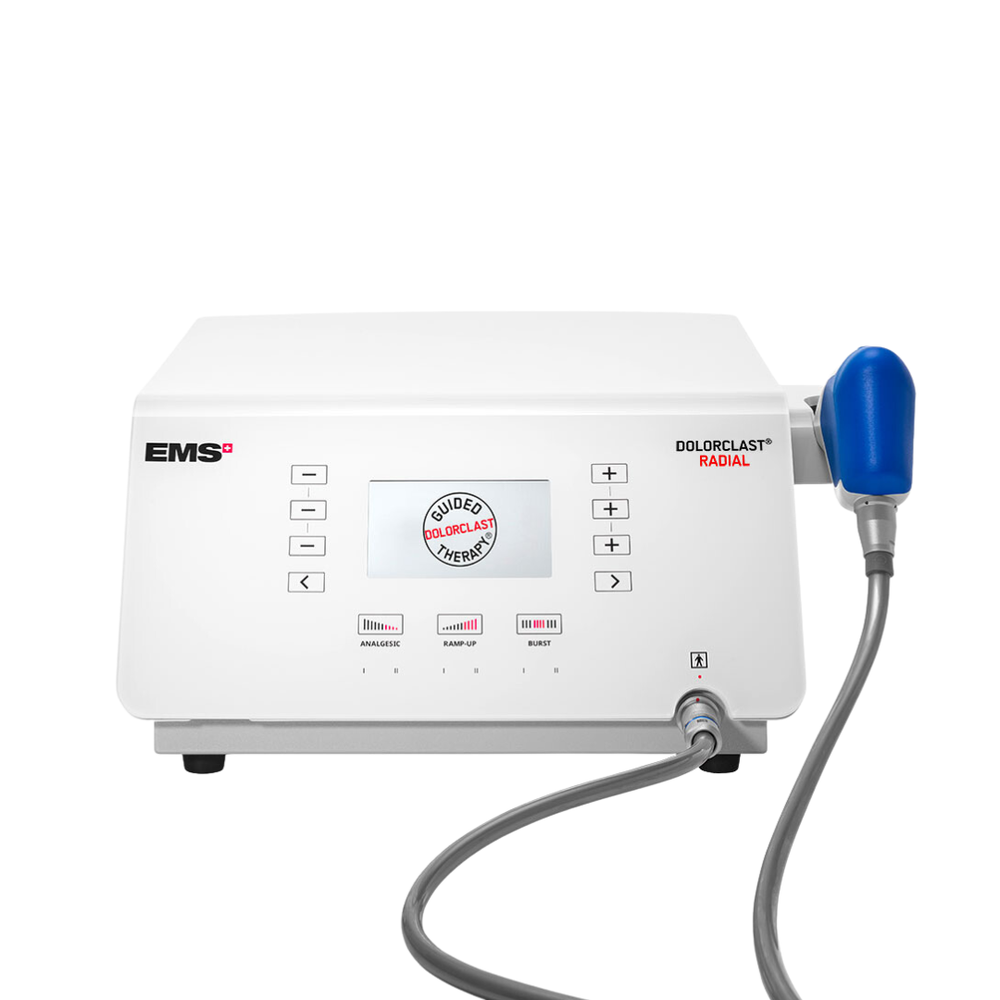
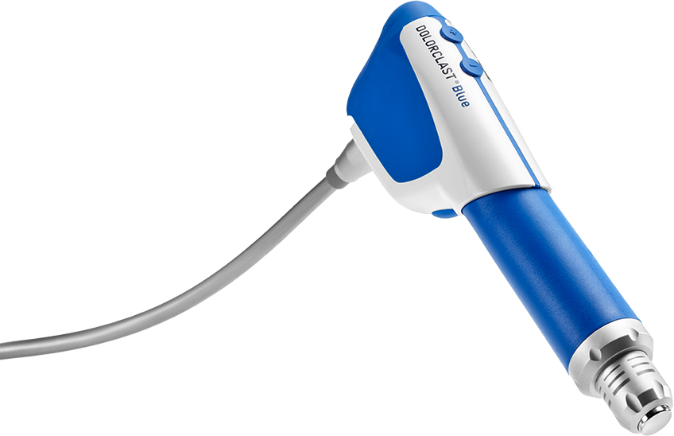

# HTML

```html
<!doctype html>
<html lang="ar" dir="rtl">
<head>
  <meta charset="utf-8">
  <meta name="viewport" content="width=device-width, initial-scale=1">
  <meta name="description" content="OrthoServ — EMS DolorClast radial shock wave device. Scene 1 design preview.">
  <meta name="theme-color" content="#F4F8FA">
  <title>OrthoServ — EMS DolorClast / Scene 1</title>
  <link rel="icon" href="assets/orthoserv-logo-symbol.png" type="image/png">
  <link rel="preload" href="assets/ems-dolorclast-console-official.png" as="image" type="image/png" fetchpriority="high">
  <link rel="preload" href="assets/fonts/ibm-400.woff2" as="font" type="font/woff2" crossorigin>
  <link rel="stylesheet" href="css/layered.css">
  <script src="js/vendor/gsap.min.js" defer></script>
  <script src="js/vendor/ScrollTrigger.min.js" defer></script>
  <script src="js/layered.js" defer></script>
</head>
<body>
  <a class="skip-link" href="#main" data-copy="skipContent">انتقل إلى المحتوى</a>
  <header class="site-header" id="header">
    <div class="header-inner">
      <a class="brand" href="#scene-1" aria-label="OrthoServ — Medical Supplies & Rehabilitation"></a>
      <nav aria-label="التنقل الرئيسي" id="navigation">
        <a href="#shockwave-models" data-copy="products">المنتجات</a>
        <button type="button" data-destination="services" data-copy="services">الخدمات</button>
        <button type="button" data-destination="juzo" lang="en" dir="ltr">Juzo</button>
        <button type="button" data-quote data-copy="business">حلول الأعمال</button>
      </nav>
      <div class="header-actions"><button type="button" class="language" id="language" aria-label="Switch to English"><span lang="ar">AR</span><span aria-hidden="true">/</span><span lang="en">EN</span></button><button type="button" class="button header-quote" data-quote data-copy="quote">اطلب عرض سعر</button></div>
    </div>
  </header>

  <main id="main" tabindex="-1">
    <section class="scene" id="scene-1" aria-labelledby="heroTitle" data-scene="dolorclast">
      <div class="scene-watermark" lang="en" dir="ltr" aria-hidden="true">RADIAL</div>
      <div class="scene-topline"><span class="eyebrow" lang="en" dir="ltr">01 / RADIAL THERAPY</span><button class="skip-animation" id="skipAnimation" type="button" aria-pressed="false"><span class="pause-symbol" aria-hidden="true">Ⅱ</span><span id="skipLabel" data-copy="skipAnimation">تخطي الحركة</span></button></div>
      <div class="hero-grid">
        <div class="artwork" id="artwork">
          <div class="device-glow" aria-hidden="true"></div>
          <div class="orbit" id="orbit" aria-hidden="true"></div>
          <canvas class="cable" id="cableCanvas" aria-hidden="true"></canvas>
          <div class="console" id="consoleBox">
            <div class="contact-shadow" aria-hidden="true"></div>
            <div class="photo-cutout console-photo">
              <picture></picture>
            </div>
          </div>
          <div class="handpiece" id="handpieceBox"><div class="handpiece-motion" id="handpieceMotion"><div class="photo-cutout handpiece-photo"><picture></picture></div></div></div>
          <canvas id="pulseCanvas" aria-hidden="true"></canvas>
          <p class="art-caption" id="pulseCaption"><span class="caption-mark" aria-hidden="true"></span><span data-copy="pulseCaption">رسم توضيحي لنبضات الموجات</span></p>
          <p class="debug-readout" id="debugReadout" lang="en" dir="ltr" hidden></p>
        </div>

        <div class="hero-copy" id="heroCopy">
          <span class="eyebrow product-eyebrow" lang="en" dir="ltr">EMS · DOLORCLAST® RADIAL SHOCK WAVES</span>
          <h1 id="heroTitle"><span data-copy="headline1">موجات الصدمة الإشعاعية.</span><span class="headline-second" data-copy="headline2">بدقة تناسب العيادة.</span></h1>
          <div class="copy-support">
          <p class="hero-description" data-copy="body">تقنية EMS للموجات الصدمية الإشعاعية، لعيادات العلاج الطبيعي ومراكز التأهيل.</p>
          <div class="hero-actions"><button type="button" class="button" data-quote><span data-copy="quote">اطلب عرض سعر</span><span aria-hidden="true">↗</span></button><button type="button" class="text-link" data-details><span data-copy="explore">استكشف الجهاز</span><span aria-hidden="true">↗</span></button></div>
          </div>
        </div>
      </div>
      <div class="scene-bottom"><div class="scroll-hint"><span class="scroll-line" aria-hidden="true"></span><span id="scrollLabel" data-copy="scroll">مرّر لتصاعد النبضات</span></div><span class="scene-signature" lang="en" dir="ltr">RADIAL SHOCK WAVE TECHNOLOGY</span></div>
    </section>

    <section class="models-section" id="shockwave-models" aria-labelledby="modelsTitle">
      <div class="models-intro"><span class="eyebrow" lang="en" dir="ltr">02 / THE SHOCK WAVE COLLECTION</span>
      <h2 id="modelsTitle" data-copy="modelsTitle">أربع وحدات.<br>عالم واحد من الدقّة.</h2>
      <p data-copy="modelsIntro">اكتشف موديلات الشوك ويف لدى أورثوسيرف، واختر الجهاز المناسب لتجهيز عيادتك.</p></div>
      <div class="models-grid" id="modelsGrid"></div>
      <p class="models-note" data-copy="modelsNote">التجهيزات والتوافر والضمان تُؤكَّد عند طلب عرض السعر.</p>
    </section>
  </main>

  <footer><span lang="en" dir="ltr">ORTHOSERV / EMS DOLORCLAST</span><p lang="en" dir="ltr">DEMO ONLY: replace with brand-approved asset</p></footer>
  <div class="mobile-quote"><button class="button" type="button" data-quote><span data-copy="quote">اطلب عرض سعر</span><span aria-hidden="true">↗</span></button></div>

  <dialog id="infoDialog" aria-labelledby="dialogTitle"><div class="dialog-top"><span class="eyebrow" lang="en" dir="ltr">ORTHOSERV / SCENE 01</span><button type="button" class="close" id="closeDialog" aria-label="إغلاق">×</button></div><h2 id="dialogTitle"></h2><p id="dialogBody"></p><div id="deviceDetails" hidden><dl><div><dt data-copy="deviceName">الجهاز</dt><dd lang="en" dir="ltr">EMS DolorClast</dd></div><div><dt data-copy="specifications">المواصفات</dt><dd data-copy="unconfirmed">[تُؤكّد]</dd></div><div><dt lang="en" dir="ltr">SFDA / MDMA</dt><dd data-copy="unconfirmed">[تُؤكّد]</dd></div><div><dt data-copy="availability">التوافر في السعودية</dt><dd data-copy="unconfirmed">[تُؤكّد]</dd></div></dl></div><div class="trust-row" aria-label="بيانات بانتظار التأكيد" id="trustRow"><p data-copy="authorized">[الوكيل المعتمد: يُؤكّد]</p><p data-copy="registration">[رقم SFDA/MDMA: يُؤكّد]</p><p data-copy="warranty">[شمول الضمان والخدمة: يُؤكّد]</p></div><p class="demo-note" data-copy="demoNote">المشهد للتوضيح البصري فقط، وليس محاكاة علاجية.</p><p class="dialog-note" data-copy="noSubmission">معاينة للمشهد فقط؛ لا يُرسل أي طلب ولا تُجمع بيانات.</p><button type="button" class="button" id="returnButton" data-copy="return">العودة للمشهد</button></dialog>
  <noscript>JavaScript مطلوب للحركة فقط. النص وصورة الجهاز متاحان بدون تشغيل الحركة. JavaScript is required for animation only.</noscript>
</body>
</html>

```

# CSS

```css
@font-face{font-family:Plex;src:url('../assets/fonts/ibm-400.woff2') format('woff2');font-weight:400;font-display:swap}
@font-face{font-family:Plex;src:url('../assets/fonts/ibm-500.woff2') format('woff2');font-weight:500;font-display:swap}
@font-face{font-family:Plex;src:url('../assets/fonts/ibm-600.woff2') format('woff2');font-weight:600;font-display:swap}
@font-face{font-family:Plex;src:url('../assets/fonts/ibm-700.woff2') format('woff2');font-weight:700;font-display:swap}
@font-face{font-family:Manrope;src:url('../assets/fonts/manrope-400.woff2') format('woff2');font-weight:400;font-display:swap}
@font-face{font-family:Manrope;src:url('../assets/fonts/manrope-600.woff2') format('woff2');font-weight:600;font-display:swap}
@font-face{font-family:Manrope;src:url('../assets/fonts/manrope-700.woff2') format('woff2');font-weight:700;font-display:swap}
:root{--ink:#122a3c;--blue:#086da8;--cyan:#159ccd;--muted:#637680;--line:#d4e1e7;--font-ar:Plex,sans-serif;--font-en:Manrope,sans-serif;--font:var(--font-ar);--copy-dir:rtl;--header-size:92px;--gutter:clamp(22px,4.2vw,76px)}
:root:lang(en){--font:var(--font-en);--copy-dir:ltr}
*{box-sizing:border-box}html{scroll-padding-block-start:var(--header-size)}
body{margin:0;font:16px/1.85 var(--font);color:var(--ink);background:#f7fbfd}
h1,h2,p{margin:0}button{font:inherit;color:inherit;cursor:pointer;border:0;background:none}a{color:inherit;text-decoration:none}
button,a{touch-action:manipulation;min-block-size:44px}button:focus-visible,a:focus-visible,main:focus-visible{outline:3px solid var(--cyan);outline-offset:5px}
[lang=en]{font-family:var(--font-en)}[lang=ar]{font-family:var(--font-ar)}[hidden]{display:none!important}
.skip-link{position:fixed;z-index:100;inset-block-start:12px;inset-inline-start:12px;background:white;padding:12px 20px;transform:translateY(-180%)}.skip-link:focus{transform:none}
.site-header{position:sticky;inset-block-start:0;z-index:30;background:#fafdfff2;border-block-end:1px solid #dae5eb}
.header-inner{max-inline-size:1760px;margin-inline:auto;min-block-size:var(--header-size);padding-inline:var(--gutter);display:flex;justify-content:space-between;align-items:center;gap:24px;direction:ltr}
.brand{display:flex;flex-direction:column;align-items:flex-start;justify-content:center;flex-shrink:0}.brand strong{font-size:29px;font-weight:700;line-height:1.2}.brand strong span{color:var(--blue)}.brand small{font-size:12px;line-height:1.7;letter-spacing:.035em;margin-block-start:5px}
.header-inner nav{display:flex;align-items:center;gap:clamp(16px,2.2vw,32px);direction:var(--copy-dir)}.header-inner nav button{font-size:14px;padding:9px 0}.header-inner nav button:hover{color:var(--blue)}
.header-actions{display:flex;gap:22px;align-items:center;direction:ltr}.language{display:flex;align-items:center;gap:8px;font-size:14px;padding:10px 0;direction:ltr}.language span[aria-hidden]{color:#a0b4bf}.language [lang=ar]{color:var(--blue);font-weight:600}:lang(en) .language [lang=en]{color:var(--blue);font-weight:700}:lang(en) .language [lang=ar]{color:var(--ink);font-weight:400}
.button{display:inline-flex;align-items:center;justify-content:center;gap:26px;min-block-size:58px;padding-block:10px;padding-inline:25px 12px;border:1px solid var(--ink);border-radius:999px;background:var(--ink);color:white;font-size:16px;font-weight:500;transition:background 180ms,box-shadow 180ms,transform 180ms}
.button>span[aria-hidden]{inline-size:36px;block-size:36px;display:grid;place-items:center;border:1px solid #ffffff50;border-radius:50%;font:20px/1 var(--font-en)}.button:hover{background:#1a415b;box-shadow:0 8px 28px #122a3c18;transform:translateY(-2px)}
.header-quote{min-block-size:46px;border-color:#9cb7c6;color:var(--ink);background:transparent;padding:8px 21px;font-size:14px}.header-quote:hover{color:white;background:var(--ink)}
.scene{position:relative;isolation:isolate;min-block-size:calc(100svh - var(--header-size));padding:18px var(--gutter) 20px;overflow:clip;background:linear-gradient(115deg,#fff 0%,#f9fcfd 38%,#e8f2f8 100%)}
.scene:before{content:'';position:absolute;inset:0;z-index:-3;pointer-events:none;background:radial-gradient(ellipse at 79% 42%,#cfe5f1a6,transparent 63%)}
.scene-watermark{position:absolute;inset-block-end:3%;inset-inline-end:0;font-size:clamp(130px,17vw,280px);font-weight:600;line-height:1;color:transparent;-webkit-text-stroke:1px #cfdee78c;letter-spacing:.025em;z-index:-1;pointer-events:none}
.scene-topline,.scene-bottom{inline-size:100%;max-inline-size:1600px;margin-inline:auto;display:flex;align-items:center;justify-content:space-between;gap:24px;position:relative;z-index:10}
.eyebrow{font-size:14px;font-weight:600;color:var(--blue);line-height:1.75}.eyebrow:lang(en){letter-spacing:.11em}.scene-topline>.eyebrow{color:var(--muted)}
.skip-animation{display:inline-flex;align-items:center;gap:10px;padding:8px 0;font-size:14px;color:var(--muted)}.skip-animation:hover{color:var(--blue)}.pause-symbol{font:17px/1 var(--font-en)}

/* The console, handpiece, cable and waves are genuinely independent layers.
   Left/right composition is deliberate and stays fixed across languages. */
.hero-grid{direction:ltr;inline-size:100%;max-inline-size:1600px;margin-inline:auto;position:relative;min-block-size:clamp(650px,calc(100svh - var(--header-size) - 108px),850px)}
.artwork{position:absolute;inset:0;direction:ltr;isolation:isolate;pointer-events:none}
.device-glow{position:absolute;inset:-8% -5% 0 32%;background:radial-gradient(ellipse at 60% 48%,#c7e0f08c,transparent 68%);z-index:0}
.orbit{position:absolute;inline-size:47%;aspect-ratio:1;inset-inline-start:49%;inset-block-start:4%;border:1px dashed #b5ccd65c;border-radius:50%;z-index:0}
.cable{position:absolute;inset:0;inline-size:100%;block-size:100%;overflow:visible;z-index:1}
.cable-shadow{stroke-width:15;transform:translateY(4px)}.cable-outer{stroke-width:12}.cable-middle{stroke-width:9}.cable-highlight{stroke-width:4.2;transform:translate(-.7px,-1px)}.cable-glint{stroke-width:1.2;transform:translate(-1px,-2px)}
.console{position:absolute;inset-inline-start:55%;inset-block-end:7%;inline-size:min(696px,44%);aspect-ratio:696/468;z-index:2}
.contact-shadow{position:absolute;inset-inline-start:6%;inset-block-end:-5%;inline-size:90%;block-size:17%;background:radial-gradient(ellipse,#122a3c29 0%,#122a3c0d 44%,transparent 72%);z-index:-1}
.photo-cutout{position:relative;inline-size:100%;block-size:100%;overflow:hidden}
.photo-cutout picture{display:contents}
.photo-cutout img{position:absolute;block-size:auto;max-inline-size:none;display:block;transform:none}
.handpiece{position:absolute;inset-inline-start:44%;inset-block-start:6%;inline-size:min(366px,28%);aspect-ratio:366/254;z-index:3}
.handpiece-motion{position:relative;inline-size:100%;block-size:100%;transform-origin:50% 50%;will-change:transform}
#pulseCanvas{position:absolute;inset:0;inline-size:100%;block-size:100%;pointer-events:none;mix-blend-mode:multiply;z-index:4}
.art-caption{position:absolute;inset-block-end:0;inset-inline-end:4%;display:flex;align-items:center;gap:10px;color:var(--muted);font-size:14px;line-height:1.7;direction:var(--copy-dir);z-index:4}
.caption-mark{inline-size:5px;block-size:5px;border-radius:50%;background:var(--cyan)}
.hero-copy{position:relative;z-index:6;inline-size:55%;min-inline-size:0;padding-block:75px 15px;direction:ltr;pointer-events:none}
.hero-copy button,.hero-copy a{pointer-events:auto}
.product-eyebrow{font-size:14px;line-height:1.8;max-inline-size:520px}
.hero-copy h1{direction:var(--copy-dir);text-align:start;font-size:clamp(42px,4.2vw,68px);font-weight:600;line-height:1.3;margin-block:20px 24px;text-shadow:0 1px 12px #fff,0 0 2px #ffffffa6}
.hero-copy h1>span{display:block}.headline-second{color:var(--blue);margin-block-start:10px}
.copy-support{direction:var(--copy-dir);text-align:start;inline-size:min(440px,78%);max-inline-size:100%;position:relative}
.hero-description{font-size:16px;line-height:1.85;color:#536b79;text-shadow:0 0 8px #fff,0 0 3px #fff}
.hero-actions{display:flex;flex-wrap:wrap;align-items:center;gap:12px 24px;margin-block-start:24px}
.text-link{display:inline-flex;align-items:center;gap:12px;min-block-size:44px;padding:8px 0;font-size:15px;color:var(--ink);text-decoration:underline;text-underline-offset:7px;text-decoration-thickness:1px}
.trust-row{display:flex;flex-wrap:wrap;gap:0 12px;border-block-start:1px solid #b7cdd86b;padding-block-start:16px;margin-block-start:23px;color:var(--muted);font-size:14px;line-height:1.8;text-shadow:0 0 6px white,0 0 3px white}.trust-row p{margin-block-end:5px}
.demo-note{margin-block-start:8px;color:var(--muted);font-size:14px;line-height:1.8;text-shadow:0 0 6px white}
.scene-bottom{padding-block-start:15px}.scroll-hint{display:flex;align-items:center;gap:12px;color:var(--muted);font-size:14px}.scroll-line{inline-size:44px;block-size:1px;background:var(--cyan)}.scene-signature{font-size:14px;color:var(--muted);line-height:1.7;letter-spacing:.05em}
.debug-readout{position:absolute;inset-block-start:0;inset-inline-end:0;max-inline-size:100%;z-index:8;pointer-events:none;font:12px/1.6 monospace;color:#8c1648;background:#fffef0e8;border:1px solid #e7a2bd;padding:8px}
footer{padding:25px var(--gutter);border-block-start:1px solid var(--line);display:flex;justify-content:space-between;flex-wrap:wrap;gap:15px;font-size:14px;color:var(--muted);background:#f6fafc}.mobile-quote{display:none}
dialog{inline-size:min(600px,calc(100% - 32px));max-block-size:90dvh;overflow:auto;border:1px solid var(--line);border-radius:18px;padding:30px;color:var(--ink);background:#fff;box-shadow:0 30px 80px #122a3c30}dialog::backdrop{background:#122a3c91}.dialog-top{display:flex;justify-content:space-between;align-items:center;gap:20px}.close{inline-size:44px;block-size:44px;font-size:28px;line-height:1}dialog h2{font-size:30px;line-height:1.4;font-weight:500;margin-block:20px}dialog>p{font-size:16px;line-height:1.85;color:var(--muted)}dialog .dialog-note{font-size:14px;border-block-start:1px solid var(--line);padding-block-start:20px;margin-block:22px}dialog dl{margin-block:22px}dialog dl>div{display:grid;grid-template-columns:1fr 1fr;gap:15px;border-block-end:1px solid var(--line);padding-block:12px;font-size:14px}dialog dd{margin:0}dialog dt{font-weight:500}
.motion-static .handpiece-motion{will-change:auto}.motion-static .orbit{display:none}
@media(min-width:1600px){.hero-copy h1{font-size:68px}.hero-copy{padding-block-start:92px}}
@media(min-width:1024px) and (max-height:800px){.hero-grid{min-block-size:620px}.hero-copy{padding-block-start:44px}.hero-copy h1{font-size:clamp(40px,4vw,60px)}.handpiece{inset-block-start:3%}}
@media(min-width:640px) and (max-width:1023px){
  :root{--header-size:126px;--gutter:24px}.header-inner{flex-wrap:wrap;gap:7px 20px;padding-block:13px}.header-inner nav{order:3;inline-size:100%;justify-content:center;gap:32px}.brand strong{font-size:27px}.header-actions{gap:18px}
  .hero-grid{min-block-size:760px}.hero-copy{inline-size:65%;padding-block-start:66px}.hero-copy h1{font-size:clamp(39px,4.9vw,50px)}.copy-support{inline-size:325px;max-inline-size:75%}.hero-actions{gap:10px 16px}.hero-actions .button{font-size:15px;gap:16px;padding-inline:20px 10px}.hero-actions .button>span[aria-hidden]{inline-size:30px;block-size:30px}
  .console{inline-size:45%;inset-inline-start:54%;inset-block-end:21%}.handpiece{inset-inline-start:49%;inset-block-start:5%;inline-size:34%}.art-caption{inset-block-end:15%;inset-inline-end:1%}.scene-signature{max-inline-size:220px}.orbit{inset-block-start:12%}
}
@media(max-width:639px){
  :root{--header-size:116px;--gutter:22px}.header-inner{padding-block:14px 6px;min-block-size:116px;flex-wrap:wrap;gap:7px 18px}.brand strong{font-size:26px}.header-actions{gap:12px}.header-quote{display:none}.header-inner nav{order:3;inline-size:100%;justify-content:space-between;gap:8px;border-block-start:1px solid var(--line);padding-block-start:4px}.header-inner nav button{font-size:14px}
  .scene{padding-block:12px 28px;background:linear-gradient(165deg,#edf6fb,#fff 68%)}.scene-watermark{display:none}.scene-topline{gap:12px}.scene-topline>.eyebrow{font-size:14px;letter-spacing:.04em;max-inline-size:170px}.skip-animation{gap:7px;white-space:nowrap}
  .hero-grid{min-block-size:0;padding-block-start:clamp(390px,110vw,510px)}.artwork{inset-block-end:auto;block-size:clamp(390px,110vw,510px)}.console{inline-size:86%;inset-inline-start:13%;inset-block-end:10%}.handpiece{inline-size:52%;inset-inline-start:36%;inset-block-start:3%}.orbit{display:none}.device-glow{inset:0 -8%}.art-caption{inset-block-end:0;inset-inline-end:0;font-size:14px}
  .hero-copy{inline-size:100%;padding-block:27px 12px;pointer-events:auto}.hero-copy h1{font-size:clamp(34px,9vw,46px);margin-block:20px 24px}.product-eyebrow{font-size:14px;line-height:1.7;letter-spacing:.04em}.copy-support{inline-size:100%;max-inline-size:100%}.hero-description{font-size:16px;line-height:1.85}.hero-actions{margin-block-start:24px;gap:10px 22px}.trust-row{margin-block-start:25px;display:block}.scene-signature{display:none}
  footer{padding-block-end:110px}.mobile-quote{display:block;position:fixed;z-index:30;inset-inline:0;inset-block-end:0;background:#ffffffef;border-block-start:1px solid var(--line);padding:10px 20px max(10px,env(safe-area-inset-bottom))}.mobile-quote .button{inline-size:100%;justify-content:space-between;min-block-size:52px;padding-inline:23px 10px}dialog{padding:22px}dialog h2{font-size:26px}.debug-readout{font-size:11px}
}
@media(prefers-reduced-motion:reduce){*,*:before,*:after{animation:none!important;transition:none!important}.handpiece-motion{will-change:auto}.orbit{display:none}}

/* Art direction revision: product-led composition, quiet material and measured space. */
body{background:#f8fafb}
.site-header{background:#fafcfdeb;border-block-end-color:#dce4e85c}
.scene{background:linear-gradient(110deg,#fafcfd 0%,#f7fafb 53%,#edf3f6 100%)}
.scene:before{background:radial-gradient(ellipse at 79% 58%,#d7e5ed66,transparent 58%)}
.scene-watermark,.orbit{display:none}
.device-glow{background:radial-gradient(ellipse at 64% 58%,#cddde633,transparent 60%)}
.scene-topline>.eyebrow{font-size:14px;color:#7c8c96;letter-spacing:.12em}
.hero-copy{inline-size:53%;padding-block-start:117px}
.product-eyebrow{font-size:14px;color:#637b89;font-weight:500;letter-spacing:.045em}
.hero-copy h1{font-size:clamp(40px,4vw,62px);line-height:1.38;font-weight:500;margin-block:25px 27px;text-shadow:0 0 18px #f9fbfd}
.headline-second{color:var(--ink);margin-block-start:0}
.copy-support{inline-size:370px;max-inline-size:80%;margin-inline-start:0}
.hero-description{color:#6c7e89;font-size:16px;line-height:1.9}
.hero-actions{margin-block-start:31px;gap:22px}
.hero-actions .button{min-block-size:54px;font-size:15px;padding-inline:23px 10px;gap:22px;background:#15384b;border-color:#15384b}
.hero-actions .button>span[aria-hidden]{inline-size:32px;block-size:32px}
.text-link{font-size:14px;color:#5b707d;text-decoration:none;border-block-end:1px solid #a9bac4;padding-block:5px}
.console{inset-inline-start:53%;inset-block-end:12%;inline-size:min(696px,46%)}
.handpiece{inset-inline-start:47%;inset-block-start:5%;inline-size:min(290px,22%)}
.cable-highlight{opacity:.55}.cable-glint{opacity:.25}.cable-shadow{opacity:.5}
.art-caption{inset-inline-end:2%;inset-block-end:3%;color:#81929c}
.scene-bottom{border-block-start:1px solid #d5e0e66b;padding-block-start:18px}
.scroll-line{inline-size:32px;background:#869eac}.scroll-hint,.scene-signature{color:#81929c}
@media(min-width:1600px){.hero-copy{padding-block-start:125px}.hero-copy h1{font-size:64px}}
@media(min-width:1024px) and (max-height:800px){.hero-copy{padding-block-start:94px}.hero-copy h1{font-size:clamp(40px,4vw,57px)}.handpiece{inset-block-start:3%}}
@media(min-width:640px) and (max-width:1023px){.hero-copy{inline-size:64%;padding-block-start:105px}.hero-copy h1{font-size:clamp(38px,4.8vw,49px)}.copy-support{inline-size:300px;max-inline-size:74%}.console{inline-size:45%;inset-inline-start:54%;inset-block-end:15%}.handpiece{inline-size:28%;inset-inline-start:53%;inset-block-start:5%}.art-caption{inset-block-end:5%}}
@media(max-width:639px){.scene{background:linear-gradient(165deg,#edf3f6,#fafcfd 65%)}.hero-copy{inline-size:100%;padding-block:30px 20px}.hero-copy h1{font-size:clamp(34px,9vw,46px);margin-block:18px 23px}.copy-support{inline-size:100%;max-inline-size:100%}.console{inline-size:86%;inset-inline-start:13%;inset-block-end:10%}.handpiece{inline-size:44%;inset-inline-start:39%;inset-block-start:7%}.art-caption{inset-block-end:0}.hero-actions{margin-block-start:26px}.scene-topline>.eyebrow{letter-spacing:.03em}.scene-bottom{margin-block-start:16px}}

/* Official EMS handpiece photograph; the matching hose is sampled in canvas. */
.handpiece{inline-size:min(225px,18%);aspect-ratio:448/548;inset-inline-start:51%;inset-block-start:0}
@media(min-width:640px) and (max-width:1023px){.handpiece{inline-size:23%;inset-inline-start:56%;inset-block-start:0}}
@media(max-width:639px){.handpiece{inline-size:35%;inset-inline-start:49%;inset-block-start:0}}

/* Higher-definition official front view. */
.console{aspect-ratio:770/510;inline-size:min(770px,46%)}
@media(min-width:640px) and (max-width:1023px){.console{inline-size:45%}}
@media(max-width:639px){.console{inline-size:86%}}

/* User-approved OrthoServ identity: preserve original artwork and proportions. */
.brand-logo{display:block;inline-size:224px;max-inline-size:263px;block-size:auto;object-fit:contain}
@media(max-width:639px){.brand-logo{inline-size:190px}}

/* Retain the original hose neck; the moving join is farther from the connector. */
.handpiece{inline-size:min(260.16px,20.8125%);aspect-ratio:518/548;inset-inline-start:calc(51% - min(35.16px,2.8125%))}
@media(min-width:640px) and (max-width:1023px){.handpiece{inline-size:26.594%;inset-inline-start:52.406%}}
@media(max-width:639px){.handpiece{inline-size:40.469%;inset-inline-start:43.531%}}

/* A continuous photographic handpiece crosses the seam into the collection. */
main{isolation:isolate}.scene{overflow:visible;z-index:2}.scene .artwork{overflow:visible}.cable{block-size:calc(100% + 430px)}
.header-inner nav a{display:inline-flex;align-items:center;font-size:14px}
.models-section{position:relative;z-index:1;padding:90px var(--gutter) 80px;background:#fff;border-block-start:1px solid #dce6ec}
.models-intro{max-inline-size:1600px;margin-inline:auto;min-block-size:300px;padding-inline-start:48%;text-align:start}
.models-intro h2{font-size:clamp(34px,3.7vw,56px);line-height:1.4;font-weight:500;max-inline-size:580px;margin-block:20px}
.models-intro>p{color:var(--muted);max-inline-size:480px;font-size:16px;line-height:1.9}
.models-grid{display:grid;grid-template-columns:repeat(4,minmax(0,1fr));gap:22px;max-inline-size:1600px;margin:35px auto 0}
.model-card{min-inline-size:0}.model-media{position:relative;aspect-ratio:1;background:#f4f6f7;border-radius:12px;padding:8%;display:grid;place-items:center;overflow:hidden;transition:background .25s}
.model-media img{inline-size:100%;block-size:100%;object-fit:contain;mix-blend-mode:multiply;min-block-size:0;min-inline-size:0}
.model-number{position:absolute;inset-block-start:13px;inset-inline-start:16px;font:12px Manrope,sans-serif;color:#84949e}
.model-info{padding:23px 3px}.model-type{font:12px Manrope,sans-serif;color:#718793;letter-spacing:.1em}.model-info h3{font:600 clamp(17px,1.4vw,22px)/1.5 Manrope,sans-serif;margin:9px 0 13px;text-align:start}.model-info>p{font-size:15px;line-height:1.9;color:var(--muted);min-block-size:58px}
.model-link{display:flex;justify-content:space-between;align-items:center;inline-size:100%;border-block-start:1px solid var(--line);margin-block-start:21px;padding:14px 0;font-size:14px}.model-link:hover{color:var(--blue)}.model-card:hover .model-media{background:#eaf0f3}.models-note{max-inline-size:1600px;margin:20px auto 0;font-size:14px;color:var(--muted);border-block-start:1px solid var(--line);padding-block-start:23px}
.motion-static .scene{overflow:clip}.motion-static .models-intro{min-block-size:170px;padding-inline-start:0}
@media(min-width:640px) and (max-width:1100px){.models-grid{grid-template-columns:repeat(2,minmax(0,1fr));gap:28px}.models-intro{padding-inline-start:44%;min-block-size:340px}}
@media(max-width:639px){.models-section{padding-block:55px}.models-intro{padding-inline-start:0;padding-block-start:210px;min-block-size:0}.models-intro h2{font-size:35px}.models-grid{grid-template-columns:1fr;gap:16px;margin-block-start:35px}.model-card{display:grid;grid-template-columns:42% 1fr;gap:18px;align-items:center;direction:ltr;border-block-end:1px solid var(--line);padding-block-end:17px}.model-info{direction:var(--copy-dir);padding:0}.model-info h3{font-size:16px}.model-type{font-size:12px}.model-info>p{font-size:14px;min-block-size:0;line-height:1.8}.model-link{margin-block-start:10px;padding-block:9px}.motion-static .models-intro{padding-block-start:0}.models-note{font-size:14px}.model-number{font-size:11px;inset-inline-start:10px;inset-block-start:8px}}

.model-card,.model-info{min-inline-size:0}.model-info h3{overflow-wrap:anywhere}
@media(max-width:639px){.model-card{grid-template-columns:42% minmax(0,1fr)}}

body{overflow-x:clip}

/* Final spacing system: shared container, aligned copy, balanced product scale. */
:root{--header-size:84px;--gutter:clamp(24px,4.5vw,72px)}
.site-header{background:#fafcfd;border-block-end:1px solid #e1e8ec}
.header-inner{max-inline-size:1512px;min-block-size:84px;gap:28px}
.brand-logo{inline-size:210px}
.scene-topline,.scene-bottom,.hero-grid,.models-grid,.models-note{max-inline-size:1368px}
.scene{padding-block:16px 24px}
.hero-grid{min-block-size:clamp(610px,calc(100svh - 190px),760px)}
.hero-copy{inline-size:50%;padding-block:120px 42px}
.product-eyebrow{display:block;max-inline-size:none;text-align:right;font-size:14px;letter-spacing:.025em}
.hero-copy h1{font-size:clamp(39px,3.8vw,58px);line-height:1.4;margin-block:23px 25px;font-weight:500}
.copy-support{inline-size:420px;max-inline-size:90%;margin-inline-start:auto}
.hero-description{font-size:17px;line-height:1.9}
.hero-actions{gap:24px;margin-block-start:27px}
.console{inline-size:min(650px,41%);inset-inline-start:58%;inset-block-end:14%}
.handpiece{inline-size:min(230px,18.8%);inset-inline-start:53%;inset-block-start:2%}
.art-caption{inset-block-end:4%;font-size:14px}
.scene-bottom{padding-block-start:17px}.scene-signature{font-size:13px}
.models-section{padding-block:76px 80px}
.models-intro{max-inline-size:1368px;min-block-size:280px;padding-inline-start:52%}
.models-intro h2{font-size:clamp(34px,3.4vw,49px);line-height:1.45;max-inline-size:510px;margin-block:18px}
.models-intro>p{max-inline-size:460px;font-size:16px}
.models-grid{gap:24px;margin-block-start:28px}
.model-media{border-radius:10px;padding:9%}
.model-info{padding:22px 2px 8px;display:flex;flex-direction:column}
.model-info h3{font-size:clamp(17px,1.4vw,21px);min-block-size:64px;margin-block:8px 10px}
.model-info>p{font-size:15px;min-block-size:60px;line-height:1.85}
.model-link{margin-block-start:22px;min-block-size:50px}
.models-note{margin-block-start:35px;padding-block-start:22px}
footer{padding-block:24px;font-size:13px}
:lang(en) .product-eyebrow{text-align:left}:lang(en) .copy-support{margin-inline-start:0}
@media(min-width:640px) and (max-width:1100px){
 .header-inner{min-block-size:112px;padding-block:12px;gap:4px 22px;flex-wrap:wrap}.header-inner nav{order:3;inline-size:100%;justify-content:center;gap:30px}.brand-logo{inline-size:190px}
 .hero-grid{min-block-size:690px}.hero-copy{inline-size:57%;padding-block-start:105px}.hero-copy h1{font-size:clamp(36px,4.5vw,47px)}.copy-support{max-inline-size:87%}.hero-description{font-size:16px}
 .console{inline-size:44%;inset-inline-start:55%;inset-block-end:15%}.handpiece{inline-size:25%;inset-inline-start:54%;inset-block-start:1%}
 .models-intro{padding-inline-start:49%;min-block-size:290px}.models-intro h2{font-size:39px}.models-grid{gap:32px 24px}.model-info h3{min-block-size:34px}.model-info>p{min-block-size:30px}
}
@media(min-width:1101px) and (max-height:780px){.hero-grid{min-block-size:590px}.hero-copy{padding-block-start:90px}.hero-copy h1{font-size:46px}}
@media(max-width:639px){
 :root{--gutter:22px}.header-inner{min-block-size:112px;padding-block:12px 5px;gap:5px 14px}.brand-logo{inline-size:180px}.header-inner nav{padding-block-start:4px}.header-inner nav button,.header-inner nav a{font-size:14px}
 .scene{padding-block:12px 24px}.scene-topline>.eyebrow{font-size:12px}.skip-animation{font-size:13px}
 .hero-grid{min-block-size:0;padding-block-start:340px}.artwork{block-size:340px}.device-glow{inset:0}
 .console{inline-size:85%;inset-inline-start:13%;inset-block-end:10%}.handpiece{inline-size:37%;inset-inline-start:45%;inset-block-start:0}
 .art-caption{inset-block-end:0;font-size:12px}.hero-copy{inline-size:100%;padding-block:30px 14px}.product-eyebrow{text-align:start;font-size:12px;line-height:1.8;max-inline-size:310px}.hero-copy h1{font-size:clamp(32px,8.5vw,43px);margin-block:17px 21px;line-height:1.45}.copy-support{inline-size:100%;max-inline-size:100%;margin:0}.hero-description{font-size:16px}.hero-actions{gap:14px 23px;margin-block-start:23px}.hero-actions .button{font-size:14px;min-block-size:52px}.text-link{font-size:14px}.scene-bottom{margin-block-start:12px;padding-block-start:16px}.scroll-hint{font-size:13px}
 .models-section{padding-block:42px 50px}.models-intro{padding-inline-start:0;padding-block-start:165px;min-block-size:0}.models-intro .eyebrow{font-size:12px;letter-spacing:.06em}.models-intro h2{font-size:34px;line-height:1.45;margin-block:16px}.models-intro>p{font-size:16px;line-height:1.85}
 .models-grid{grid-template-columns:1fr;gap:28px;margin-block-start:30px}.model-card{display:block;padding-block-end:0;border:0}.model-media{inline-size:100%;aspect-ratio:1;padding:12%}.model-number{font-size:12px;inset:14px auto auto 17px}.model-info{padding:18px 1px 0}.model-info h3{font-size:21px;min-block-size:0;margin-block:8px 11px}.model-info>p{font-size:15px;min-block-size:0}.model-link{margin-block-start:16px;padding-block:12px}.models-note{margin-block-start:28px}
 .mobile-quote{padding-block:8px max(8px,env(safe-area-inset-bottom));background:#fafcfd}.mobile-quote .button{min-block-size:48px;font-size:14px}footer{padding-block-end:96px}
}

@media(min-width:640px){.copy-support{margin-left:auto;margin-right:0}:lang(en) .copy-support{margin-left:0;margin-right:auto}.art-caption{left:auto;right:1%}}

.models-intro h2{text-wrap:balance}.model-type{font-size:14px}.scene-signature,footer{font-size:14px}
@media(max-width:639px){.scene-topline>.eyebrow,.skip-animation,.product-eyebrow,.art-caption,.models-intro .eyebrow,.scroll-hint{font-size:14px}.scene-topline>.eyebrow{letter-spacing:0}.models-intro .eyebrow{letter-spacing:.025em}}

.models-intro{padding-inline-start:0;padding-left:0;padding-right:52%}
@media(min-width:640px) and (max-width:1100px){.models-intro{padding-right:49%}}
@media(max-width:639px){.models-intro{padding-right:0}}
.motion-static .models-intro{padding-right:0}

```

# JavaScript

```javascript
'use strict';

// Original console photograph and official EMS Blue handpiece photograph.
// Hose pixels are sampled from the official asset and mapped along a live curve.
const CONFIG = Object.freeze({
  original:{width:884,height:817},
  console:{
    original:{width:1080,height:1080},crop:{x:120,y:330,width:770,height:510},plug:{x:761,y:800},
    mask:[[214,337],[792,337],[842,414],[887,414],[879,544],[860,544],[874,738],[866,768],[831,784],[828,816],[815,838],[778,838],[760,818],[199,818],[198,837],[173,837],[162,816],[164,785],[143,779],[126,757],[122,730],[143,429]]
  },
  handpiece:{
    original:{width:848,height:548},crop:{x:330,y:0,width:518,height:548},
    inlet:{x:340,y:300},tip:{x:824,y:523},axisDeg:59,coneDeg:30,
    mask:[[330,0],[848,0],[848,548],[330,548]]
  },
  motion:{y:2.5,x:1.5,rotation:.25,period:8,pointer:2,recoil:.8,recoilDuration:.14},
  cable:{stiffness:42,damping:11,lagGain:.8,desktopBendX:.37,mobileBendX:.05},
  pulse:{delay:.6,interval:[1.4,.55],rings:[3,5],radius:[380,520],duration:1.9,stagger:.12,segments:28,alpha:.32,alphaBoost:.15,line:[2,.5],flashDuration:.16,flashRadius:17,glowBoost:.4},
  mobile:{breakpoint:640,interval:1.8,rings:2,radius:260},
  scroll:{distanceVh:160,scrub:.6,handpieceTravel:{x:10,y:-6,rotation:.6}},dprCap:2,orbitPeriod:90
});

(() => {
  const $=s=>document.querySelector(s),root=document.documentElement;
  const canvas=$('#pulseCanvas'),ctx=canvas.getContext('2d',{alpha:true});
  const art=$('#artwork'),hand=$('#handpieceMotion'),cable=$('#cableCanvas'),hoseCtx=cable.getContext('2d',{alpha:true});
  const debug=new URLSearchParams(location.search).get('debug')==='1';
  const forceReduced=new URLSearchParams(location.search).get('motion')==='reduce';
  const reduced=matchMedia('(prefers-reduced-motion: reduce)'),mobile=matchMedia('(max-width: 639px)');
  const ar={};document.querySelectorAll('[data-copy]').forEach(el=>ar[el.dataset.copy]=el.textContent);ar.scroll='مرّر لاكتشاف الموديلات';
  Object.assign(ar,{resume:'تشغيل الحركة',static:'عرض ثابت · تمرير عادي',reduced:'عرض ثابت حسب تفضيل الحركة',mobile:'استكشف الجهاز بالتمرير',quoteTitle:'طلب عرض سعر — EMS DolorClast',quoteBody:'نقطة طلب عرض السعر للمراجعة. مسار الاستفسار الكامل يُبنى بعد اعتماد المشهد.',destination:'هذه الوجهة خارج نطاق المعاينة الحالية. المعروض هنا هو جهاز الشوك ويف فقط.',close:'إغلاق',modelsTitle:'أربع وحدات. عالم واحد من الدقّة.',modelsIntro:'اكتشف موديلات الشوك ويف لدى أورثوسيرف، واختر الجهاز المناسب لتجهيز عيادتك.',modelsNote:'التجهيزات والتوافر والضمان تُؤكَّد عند طلب عرض السعر.'});
  const en={skipContent:'Skip to content',products:'Products',services:'Services',business:'Business solutions',quote:'Request a quote',skipAnimation:'Skip animation',resume:'Enable animation',static:'Static view · native scrolling',reduced:'Static view · reduced motion',mobile:'Scroll to explore the device',headline1:'Radial shock wave therapy.',headline2:'Built for the clinic.',body:'EMS radial shock wave technology for physiotherapy clinics and rehabilitation centers.',explore:'Explore the device',authorized:'[Authorized distributor: to be confirmed]',registration:'[SFDA/MDMA No.: to be confirmed]',warranty:'[Warranty & service included: to be confirmed]',pulseCaption:'Illustration of radial pulses',demoNote:'Animation preview, not a treatment simulation.',scroll:'Scroll to explore the collection',deviceName:'Device',specifications:'Specifications',unconfirmed:'[To be confirmed]',availability:'Availability in Saudi Arabia',noSubmission:'Scene preview only. No requests are sent and no data is collected.',return:'Return to the scene',quoteTitle:'Request a quote — EMS DolorClast',quoteBody:'Quote entry for scene review. The full enquiry journey follows scene approval.',destination:'This destination is outside the current preview. Only the shock wave device is presented here.',close:'Close',modelsTitle:'Four devices. One world of precision.',modelsIntro:'Explore the OrthoServ shock wave collection and find the device for your clinic.',modelsNote:'Configuration, availability and warranty are confirmed with your quotation.'};
  let products=[];
  const s={lang:'ar',ready:false,inView:false,running:false,skipped:false,mobile:mobile.matches,reduced:reduced.matches||forceReduced,clock:0,next:.6,progress:{value:0},intensity:0,pulses:[],flash:-100,width:1,height:1,dpr:1,hp:null,body:null,pose:{x:0,y:0,r:-18},spring:{x:0,y:0,vx:0,vy:0},pointer:{x:0,y:0},timeline:null,dialog:'quote',debugAt:0};
  const t=k=>(s.lang==='ar'?ar:en)[k]||ar[k]||k;
  const clamp=(v,a=0,b=1)=>Math.max(a,Math.min(b,v));
  const mix=(a,b,p)=>a+(b-a)*p;
  const axis=CONFIG.handpiece.axisDeg*Math.PI/180,cone=CONFIG.handpiece.coneDeg*Math.PI/180;

  function maskPhoto(id,part){
    const image=$(id),c=part.crop,original=part.original||CONFIG.original;
    image.style.inlineSize=`${original.width/c.width*100}%`;
    image.style.insetInlineStart=`${-c.x/c.width*100}%`;
    image.style.insetBlockStart=`${-c.y/c.height*100}%`;
    image.style.clipPath=`polygon(${part.mask.map(p=>`${p[0]/original.width*100}% ${p[1]/original.height*100}%`).join(',')})`;
  }
  maskPhoto('#consoleImage',CONFIG.console);maskPhoto('#handpieceImage',CONFIG.handpiece);

  function anchor(box,part,point,pose={x:0,y:0,r:0}){
    const px=(point.x-part.crop.x)/part.crop.width*box.w-box.w/2;
    const py=(point.y-part.crop.y)/part.crop.height*box.h-box.h/2;
    const rad=pose.r*Math.PI/180;
    return{x:box.x+box.w/2+(px*Math.cos(rad)-py*Math.sin(rad))*(pose.scale??1)+pose.x,y:box.y+box.h/2+(px*Math.sin(rad)+py*Math.cos(rad))*(pose.flipY??1)*(pose.scale??1)+pose.y};
  }
  function measure(){
    const a=art.getBoundingClientRect(),hp=$('#handpieceBox').getBoundingClientRect(),body=$('#consoleBox').getBoundingClientRect();
    if(!a.width||!a.height)return;
    s.width=a.width;s.height=a.height;s.dpr=Math.min(devicePixelRatio||1,CONFIG.dprCap);
    s.hp={x:hp.x-a.x,y:hp.y-a.y,w:hp.width,h:hp.height};s.body={x:body.x-a.x,y:body.y-a.y,w:body.width,h:body.height};
    canvas.width=Math.round(a.width*s.dpr);canvas.height=Math.round(a.height*s.dpr);
    s.travelDistance=$('#shockwave-models').getBoundingClientRect().top-a.top+40;
    cable.width=canvas.width;cable.height=Math.round((s.height+Math.max(430,s.travelDistance))*s.dpr);cable.style.height=`${s.height+Math.max(430,s.travelDistance)}px`;
    drawCable();if(!s.running)staticFrame();
  }
  // Photograph-derived hose: each strip retains the manufacturer's real
  // transverse shading. Only its path changes; no synthetic metallic strokes.
  const hoseSource=new Image();hoseSource.src='assets/ems-blue-handpiece-official.png';hoseSource.addEventListener('load',()=>{if(s.ready&&!s.running)staticFrame();});
  const hoseCenters=[[0,442],[30,438],[60,434],[90,429],[120,422],[150,414],[180,403],[210,390],[240,375],[270,356],[300,334],[330,309],[340,300]];
  function sourcePoint(u){const f=u*(hoseCenters.length-1),i=Math.min(hoseCenters.length-2,Math.floor(f)),v=f-i;return{x:mix(hoseCenters[i][0],hoseCenters[i+1][0],v),y:mix(hoseCenters[i][1],hoseCenters[i+1][1],v)};}
  function bezier(a,c,d,b,t){const v=1-t;return{x:v*v*v*a.x+3*v*v*t*c.x+3*v*t*t*d.x+t*t*t*b.x,y:v*v*v*a.y+3*v*v*t*c.y+3*v*t*t*d.y+t*t*t*b.y};}
  function drawCable(){
    if(!s.hp||!s.body||!hoseCtx||!hoseSource.complete)return;
    hoseCtx.setTransform(1,0,0,1,0,0);hoseCtx.clearRect(0,0,cable.width,cable.height);
    const a=anchor(s.body,CONFIG.console,CONFIG.console.plug),b=anchor(s.hp,CONFIG.handpiece,CONFIG.handpiece.inlet,s.pose);
    const mid={x:s.width*mix(s.mobile?.09:.37,s.mobile?.40:.67,s.intensity)+s.spring.x,y:mix(s.height*.51,s.hp.y+s.travelDistance+s.hp.h*.7,s.intensity)+s.spring.y};
    const first=[a,{x:a.x-s.width*.055,y:a.y+s.height*.09},{x:mid.x+s.width*.13,y:mid.y+s.height*.22},mid];
    // Match the original hose tangent, transformed with the handpiece pose.
    const tangent=(-42+s.pose.r)*Math.PI/180*(s.pose.flipY<0?-1:1),lead=Math.min(95,s.width*.075);
    const second=[mid,{x:mid.x-s.width*.06,y:mid.y-s.height*.13},{x:b.x-Math.cos(tangent)*lead,y:b.y-Math.sin(tangent)*lead},b];
    const landing=[a,{x:a.x+s.width*.045,y:a.y+s.height*.25},{x:b.x-Math.cos(tangent)*lead,y:b.y-Math.sin(tangent)*lead},b];
    const point=t=>{const q=t<.53?bezier(...first,t/.53):bezier(...second,(t-.53)/.47),r=bezier(...landing,t),blend=s.intensity*s.intensity*(3-2*s.intensity);return{x:mix(q.x,r.x,blend),y:mix(q.y,r.y,blend)};};
    const thickness=Math.max(6,Math.min(14,s.body.w/770*15));
    const count=260;
    for(let i=0;i<count;i++){
      const t=i/count,q=point(t),next=point((i+1)/count),src=sourcePoint(t),src2=sourcePoint(Math.min(1,t+.003));
      const angle=Math.atan2(next.y-q.y,next.x-q.x),sourceAngle=Math.atan2(src2.y-src.y,src2.x-src.x),length=Math.hypot(next.x-q.x,next.y-q.y);
      hoseCtx.save();hoseCtx.scale(s.dpr,s.dpr);hoseCtx.translate(q.x,q.y);hoseCtx.rotate(angle);
      hoseCtx.beginPath();hoseCtx.rect(-.6,-thickness*.8,length+1.2,thickness*1.6);hoseCtx.clip();
      const blend=clamp((t-.72)/.28),endThickness=22*s.hp.w/CONFIG.handpiece.crop.width*(s.pose.scale??1);
      const scale=mix(thickness,endThickness,blend)/22;hoseCtx.scale(scale,scale);hoseCtx.rotate(-sourceAngle);hoseCtx.translate(-src.x,-src.y);hoseCtx.drawImage(hoseSource,0,0);hoseCtx.restore();
    }
  }
  function clear(){if(!ctx)return;ctx.setTransform(1,0,0,1,0,0);ctx.clearRect(0,0,canvas.width,canvas.height);ctx.setTransform(s.dpr,0,0,s.dpr,0,0);}
  function arc(origin,radius,alpha,width,u=0){
    if(!ctx)return;
    const direction=axis+s.pose.r*Math.PI/180;
    const red=Math.round(mix(21,191,u)),green=Math.round(mix(156,227,u)),blue=Math.round(mix(205,242,u));
    ctx.lineCap='round';ctx.lineWidth=width;
    for(let i=0;i<CONFIG.pulse.segments;i++){
      const v=(i+.5)/CONFIG.pulse.segments,angle=direction-cone+cone*2*v;
      const x=origin.x+Math.cos(angle)*radius,y=origin.y+Math.sin(angle)*radius;
      const edge=clamp(Math.min(s.width-x,s.height-y,x,y)/30);
      const opacity=alpha*Math.pow(Math.sin(v*Math.PI),1.35)*edge;if(opacity<.005)continue;
      ctx.strokeStyle=`rgba(${red},${green},${blue},${opacity})`;
      ctx.beginPath();ctx.arc(origin.x,origin.y,radius,direction-cone+cone*2*i/CONFIG.pulse.segments,direction-cone+cone*2*(i+1.06)/CONFIG.pulse.segments);ctx.stroke();
    }
  }
  function debugDraw(origin){
    if(!debug||!ctx)return;
    const direction=axis+s.pose.r*Math.PI/180;
    ctx.save();ctx.fillStyle='#d52163';ctx.strokeStyle='#d52163';ctx.lineWidth=1.3;ctx.setLineDash([4,5]);
    ctx.beginPath();ctx.moveTo(origin.x,origin.y);ctx.lineTo(origin.x+Math.cos(direction)*130,origin.y+Math.sin(direction)*130);ctx.stroke();
    [direction-cone,direction+cone].forEach(a=>{ctx.beginPath();ctx.moveTo(origin.x,origin.y);ctx.lineTo(origin.x+Math.cos(a)*160,origin.y+Math.sin(a)*160);ctx.stroke();});
    ctx.setLineDash([]);[origin,anchor(s.body,CONFIG.console,CONFIG.console.plug),anchor(s.hp,CONFIG.handpiece,CONFIG.handpiece.inlet,s.pose)].forEach(p=>{ctx.beginPath();ctx.arc(p.x,p.y,3.5,0,Math.PI*2);ctx.fill();});ctx.restore();
  }
  function staticFrame(){
    if(!s.hp||!s.body)return;
    s.pose={x:0,y:0,r:-18};hand.style.transform='rotate(-18deg)';$('#consoleBox').style.opacity='1';s.spring={x:0,y:0,vx:0,vy:0};drawCable();clear();
    const tip=anchor(s.hp,CONFIG.handpiece,CONFIG.handpiece.tip),scale=s.hp.w/CONFIG.handpiece.crop.width;
    if(s.reduced||s.skipped)[24,46,70].forEach((r,i)=>arc(tip,r*scale,.28-i*.05,1.4));debugDraw(tip);
  }
  function emit(){const p=CONFIG.pulse;s.pulses.push({born:s.clock,rings:s.mobile?CONFIG.mobile.rings:Math.round(mix(...p.rings,s.intensity)),radius:s.mobile?CONFIG.mobile.radius:mix(...p.radius,s.intensity),alpha:p.alpha*(1+p.alphaBoost*s.intensity)});s.flash=s.clock;}
  function frame(_time,delta){
    if(!s.hp)return;const dt=Math.min(delta/1000,.05);s.clock+=dt;
    const target=clamp(s.progress.value);s.intensity+=(target-s.intensity)*(1-Math.exp(-6*dt));
    if(s.clock>=s.next){emit();s.next=s.clock+(s.mobile?CONFIG.mobile.interval:mix(...CONFIG.pulse.interval,s.intensity));}
    const m=CONFIG.motion,p=CONFIG.pulse,travel=CONFIG.scroll.handpieceTravel;
    const age=s.clock-s.flash,recoil=age>=0&&age<m.recoilDuration?Math.sin(Math.PI*age/m.recoilDuration)*m.recoil:0;
    const amplitude=s.mobile?.28:1;
    s.pose={x:(Math.sin(s.clock*.73)*m.x+s.pointer.x*m.pointer)*amplitude-Math.cos(axis)*recoil+travel.x*s.intensity+(s.mobile?0:s.width*.14)*s.intensity,y:(Math.sin(s.clock*Math.PI*2/m.period)*m.y+s.pointer.y*2)*amplitude-Math.sin(axis)*recoil+travel.y*s.intensity+s.travelDistance*s.intensity,r:-18+Math.sin(s.clock*.65)*m.rotation*amplitude+139*s.intensity};
    const flipProgress=clamp((s.intensity-.45)/.4);s.pose.flipY=Math.cos(Math.PI*flipProgress*flipProgress*(3-2*flipProgress));s.pose.scale=mix(1,.88,s.intensity);
    $('#consoleBox').style.opacity=String(1-clamp((s.intensity-.12)/.6));
    hand.style.transform=`translate3d(${s.pose.x}px,${s.pose.y}px,0) scale(${s.pose.scale}) scaleY(${s.pose.flipY}) rotate(${s.pose.r}deg)`;
    const spring=s.spring,k=CONFIG.cable.stiffness,damping=CONFIG.cable.damping;
    spring.vx+=(((s.pose.x-(travel.x+(s.mobile?0:s.width*.14))*s.intensity)*CONFIG.cable.lagGain-spring.x)*k-spring.vx*damping)*dt;spring.vy+=(((s.pose.y-(travel.y+s.travelDistance)*s.intensity)*CONFIG.cable.lagGain-spring.y)*k-spring.vy*damping)*dt;spring.x+=spring.vx*dt;spring.y+=spring.vy*dt;
    drawCable();if(!s.mobile)$('#orbit').style.transform=`rotate(${s.clock*360/CONFIG.orbitPeriod}deg)`;clear();
    const tip=anchor(s.hp,CONFIG.handpiece,CONFIG.handpiece.tip,s.pose),scale=s.hp.w/CONFIG.handpiece.crop.width;
    s.pulses=s.pulses.filter(pulse=>s.clock-pulse.born<p.duration+(pulse.rings-1)*p.stagger);
    s.pulses.forEach(pulse=>{for(let ring=0;ring<pulse.rings;ring++){const elapsed=s.clock-pulse.born-ring*p.stagger;if(elapsed<0||elapsed>p.duration)continue;const u=elapsed/p.duration,ease=1-Math.pow(1-u,3);arc(tip,mix(12,pulse.radius,ease)*scale,pulse.alpha*(1-u),mix(...p.line,ease)*scale,ease);}});
    if(ctx&&age>=0&&age<p.flashDuration){const alpha=Math.sin(Math.PI*age/p.flashDuration)*p.alpha*(1+p.glowBoost*s.intensity),r=p.flashRadius*scale;const g=ctx.createRadialGradient(tip.x,tip.y,0,tip.x,tip.y,r);g.addColorStop(0,`rgba(245,254,255,${alpha})`);g.addColorStop(.3,`rgba(21,156,205,${alpha*.8})`);g.addColorStop(1,'rgba(21,156,205,0)');ctx.fillStyle=g;ctx.fillRect(tip.x-r,tip.y-r,r*2,r*2);}
    debugDraw(tip);
    if(debug&&s.clock-s.debugAt>.25){root.dataset.scrollProgress=s.progress.value.toFixed(3);root.dataset.pulseIntensity=s.intensity.toFixed(3);s.debugAt=s.clock;}
  }
  function sync(){
    const run=s.ready&&s.inView&&!document.hidden&&!s.skipped&&!s.reduced&&!!window.gsap&&!!ctx;
    root.dataset.animationRunning=String(run);if(run===s.running)return;s.running=run;
    if(run){s.next=s.clock+.6;gsap.ticker.add(frame);}else{if(window.gsap)gsap.ticker.remove(frame);s.pulses.length=0;staticFrame();}
  }
  function motionLabels(){const plain=s.reduced||s.skipped;root.classList.toggle('motion-static',plain);root.dataset.motionMode=s.reduced?'reduced':s.skipped?'skipped':s.mobile?'mobile':'desktop';$('#skipAnimation').disabled=s.reduced;$('#skipAnimation').setAttribute('aria-pressed',String(plain));$('#skipLabel').textContent=t(s.reduced?'reduced':s.skipped?'resume':'skipAnimation');$('#scrollLabel').textContent=t(plain?'static':s.mobile?'mobile':'scroll');}
  function setup(){
    if(s.timeline){s.timeline.scrollTrigger?.kill(true);s.timeline.kill();s.timeline=null;}
    s.mobile=mobile.matches;s.reduced=reduced.matches||forceReduced;s.progress.value=0;s.intensity=0;s.pulses.length=0;
    const hh=$('#header').getBoundingClientRect().height;root.style.setProperty('--header-size',`${hh}px`);measure();
    const canPin=false;
    root.dataset.scrollPinned=String(canPin&&!s.skipped&&!s.reduced);
    if(!s.reduced&&!s.skipped&&window.gsap&&window.ScrollTrigger){gsap.registerPlugin(ScrollTrigger);s.timeline=gsap.to(s.progress,{value:1,ease:'none',duration:1,scrollTrigger:{id:'dolorclast-layered',trigger:'#scene-1',start:()=>`top top+=${$('#header').getBoundingClientRect().height}`,end:()=>`+=${$('#scene-1').offsetHeight*.88}`,scrub:s.mobile?.35:.65,invalidateOnRefresh:true}});}
    motionLabels();sync();if(!s.running)staticFrame();
  }
  function renderProducts(){
    $('#modelsGrid').innerHTML=products.map((p,i)=>`<article class="model-card"><div class="model-media"><span class="model-number" aria-hidden="true">0${i+1}</span></div><div class="model-info"><span class="model-type" lang="en">${p.type}</span><h3 lang="en" dir="ltr">${p.name}</h3><p>${p[s.lang]}</p><button class="model-link" data-model="${p.id}">${t('explore')} <span aria-hidden="true">↗</span></button></div></article>`).join('');
  }
  fetch('products.json').then(r=>{if(!r.ok)throw Error('Products unavailable');return r.json();}).then(data=>{products=data;renderProducts();}).catch(()=>{$('#modelsGrid').textContent='تعذّر تحميل الموديلات. يرجى تحديث المعاينة. / Please refresh to load the models.';});
  function showDialog(kind){s.dialog=kind;$('#dialogTitle').textContent=kind==='device'?'EMS DolorClast':kind==='quote'?t('quoteTitle'):kind==='juzo'?'Juzo':t('services');$('#dialogBody').textContent=t(kind==='device'?'body':kind==='quote'?'quoteBody':'destination');$('#deviceDetails').hidden=kind!=='device';$('#deviceDetails dd[lang]').textContent='EMS DolorClast Radial';if(!$('#infoDialog').open)$('#infoDialog').showModal();}
  function translate(){renderProducts();root.lang=s.lang;root.dir=s.lang==='ar'?'rtl':'ltr';document.title=s.lang==='ar'?'OrthoServ — EMS DolorClast':'OrthoServ — DolorClast';document.querySelectorAll('[data-copy]').forEach(el=>el.textContent=t(el.dataset.copy));$('#language').setAttribute('aria-label',s.lang==='ar'?'Switch to English':'التبديل للعربية');$('#navigation').setAttribute('aria-label',s.lang==='ar'?'التنقل الرئيسي':'Main navigation');$('#trustRow').setAttribute('aria-label',s.lang==='ar'?'بيانات بانتظار التأكيد':'Information awaiting confirmation');$('#closeDialog').setAttribute('aria-label',t('close'));motionLabels();if(s.ready)setup();}
  $('#language').addEventListener('click',()=>{s.lang=s.lang==='ar'?'en':'ar';translate();});
  $('#skipAnimation').addEventListener('click',()=>{if(s.reduced)return;s.skipped=!s.skipped;setup();if(s.skipped)$('#scene-1').scrollIntoView({block:'start',behavior:'instant'});});
  document.addEventListener('click',e=>{const modelButton=e.target.closest('[data-model]');if(modelButton){const product=products.find(p=>p.id===modelButton.dataset.model);showDialog('device');$('#dialogTitle').textContent=product.name;$('#dialogBody').textContent=product[s.lang];$('#deviceDetails dd[lang]').textContent=product.name;}if(e.target.closest('[data-quote]'))showDialog('quote');if(e.target.closest('[data-details]'))showDialog('device');const d=e.target.closest('[data-destination]');if(d)showDialog(d.dataset.destination);});
  $('#closeDialog').addEventListener('click',()=>$('#infoDialog').close());$('#returnButton').addEventListener('click',()=>$('#infoDialog').close());
  $('#scene-1').addEventListener('pointermove',e=>{if(s.mobile)return;s.pointer.x=clamp(e.clientX/innerWidth*2-1,-1,1);s.pointer.y=clamp(e.clientY/innerHeight*2-1,-1,1);});$('#scene-1').addEventListener('pointerleave',()=>{s.pointer={x:0,y:0};});
  new IntersectionObserver(entries=>{s.inView=entries[0].isIntersecting;sync();},{threshold:.01}).observe($('#main'));
  new ResizeObserver(()=>measure()).observe(art);
  document.addEventListener('visibilitychange',sync);reduced.addEventListener('change',setup);mobile.addEventListener('change',setup);
  let timer;addEventListener('resize',()=>{clearTimeout(timer);timer=setTimeout(()=>{if(s.ready)setup();},160);});
  if(debug){$('#debugReadout').hidden=false;$('#debugReadout').textContent='Official EMS Blue: tip 824,523 · axis 59° / pose −18° · photo-textured hose';}
  Promise.all([$('#consoleImage'),$('#handpieceImage')].map(i=>i.decode?i.decode().catch(()=>{}):Promise.resolve())).then(()=>{s.ready=true;translate();if(!window.gsap||!window.ScrollTrigger||!ctx){s.skipped=true;setup();}if(document.fonts)document.fonts.ready.then(()=>{measure();if(window.ScrollTrigger)ScrollTrigger.refresh();});});
})();

```

# Products

```json
[
  {
    "id": "focused",
    "name": "DolorClast® Focused",
    "type": "FOCUSED",
    "image": "assets/ems-focused-official.png",
    "width": 810,
    "height": 635,
    "ar": "الموجات الصدمية المركّزة، مع واجهة تحكّم بشاشة لمس.",
    "en": "Focused shock waves with a touchscreen interface.",
    "role": "product",
    "usage": "DEMO ONLY: replace with brand-approved asset"
  },
  {
    "id": "radial",
    "name": "DolorClast® Radial",
    "type": "RADIAL",
    "image": "assets/ems-dolorclast-console-official.png",
    "width": 1080,
    "height": 1080,
    "ar": "الموجات الصدمية الإشعاعية، مع هاندبيس DolorClast Blue.",
    "en": "Radial shock waves with the DolorClast Blue handpiece.",
    "role": "product",
    "usage": "DEMO ONLY: replace with brand-approved asset"
  },
  {
    "id": "smart20",
    "name": "Swiss DolorClast® Smart20",
    "type": "RADIAL",
    "image": "assets/ems-smart20-official.jpg",
    "width": 2048,
    "height": 1709,
    "ar": "وحدة Smart20، بواجهة تشغيل مباشرة وتصميم مدمج.",
    "en": "The compact Smart20 with a direct control interface.",
    "role": "product",
    "usage": "DEMO ONLY: replace with brand-approved asset"
  },
  {
    "id": "classic",
    "name": "Swiss DolorClast® Classic",
    "type": "RADIAL",
    "image": "assets/ems-classic-official.png",
    "width": 1280,
    "height": 742,
    "ar": "موديل Classic، بشاشة رقمية وأزرار تحكّم مستقلة.",
    "en": "The Classic model with digital display and separate controls.",
    "role": "product",
    "usage": "DEMO ONLY: replace with brand-approved asset"
  }
]
```